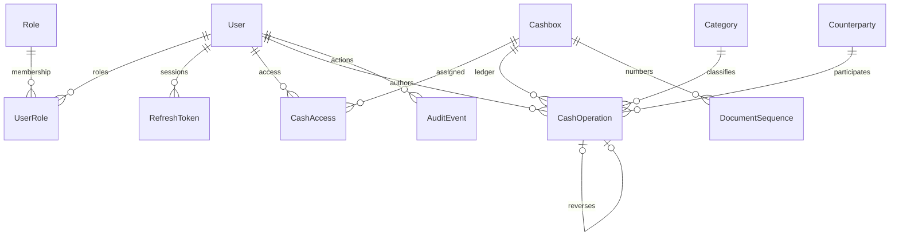

# Архитектура и правила учёта

backend/src/FaizaCash.Domain: независимые сущности и денежные правила Money. Application: DTO, интерфейсы ILedgerService/IPdfReport/ICurrentActor, BalanceRules. Infrastructure: EF DbContext, PostgreSQL миграции, транзакционная реализация LedgerService, PBKDF2 и JWT, PDF и файловый JSON логгер. Api: композиция DI, маршруты HTTP в Controllers/ApiEndpoints.cs, middleware доступа, кэша и ошибок. Группы endpoint используют Minimal API; отдельный MVC ControllerBase не нужен. Часть простых CRUD сценариев реализована в endpoint модуле; дальнейший рост предполагает перенос в Application use cases.

Клиент: frontend/src/app — приложение и навигация, pages — страницы входа и смены пароля, components — общие элементы, services — HTTP и обновление токенов, styles — темы и адаптивность, utils — отображение сумм и даты. Между клиентом и сервером только HTTP; npm и NuGet зависимости разделены.

После доработки в pages также находятся UsersPage, AuditPage и ReportsPage. Hooks/usePageData привязывает ответ к странице и фильтрам, отменяет старый запрос; это предотвращает передачу строк операций в таблицу пользователей. Hooks/useRoute хранит раздел и фильтры в URL без дополнительной библиотеки маршрутизации. Контракт пользователя явный: UserDto на C# и проверка массива ролей в services/contracts.js. ErrorBoundary изолирует ошибку отображения от основного меню. AuditEndpoints, ReportEndpoints и DirectoryEndpoints выделяют соответствующие маршруты из общего модуля. Их бизнес-правила и финансовые ограничения продолжают проверяться сервером.

Добавлен GET /api/reports/cashbook с серверной пагинацией и остатком каждой строки. Книга показывает все проведённые записи выбранной кассы за период; фильтрация части движений не используется для выдачи ложного остатка. CSV/PDF журнала принимают те же q/type/status/categoryId/counterpartyId/sort, что и список, и выгружают весь найденный набор. Пропущенный status экспорта сохраняет прежний смысл «проведённые»; status=all явно включает черновики. PATCH операции получил необязательный clearCounterparty: true для очистки контрагента; старый запрос без этого поля сохраняет прежнее значение.

## Проведение

Транзакция блокирует строку кассы FOR UPDATE, повторно читает черновик, проверяет права и остаток во всей хронологии. Сумма decimal/numeric(18,2), больше нуля и не более двух знаков: лишняя точность отклоняется, скрытого округления нет. Создаётся уникальный номер в области касса + тип + год, счётчик и аудит фиксируются в той же транзакции. При сбое аудита проведение откатывается. Параллельные расходы сериализуются по кассе; повторное проведение возвращает 409. RequestKey уникален для автора, повтор создания возвращает прежний черновик, иной payload с тем же ключом отклоняется.

Черновик редактируется с Version (optimistic concurrency), проведённый документ нельзя менять/удалять. Триггеры PostgreSQL защищают аудит от UPDATE/DELETE и основные поля проведённых документов от изменения. Владелец БД всё ещё может менять схему; это не криптографическая защита от администратора PostgreSQL. Исправление — отдельная обратная операция с причиной и ссылкой; повторный обратный документ ограничен уникальным индексом. Документ сохраняет posted, отметка ReversalId показывает связь с проведённым сторно. Баланс включает обе записи, не вычитает исходную повторно.

Техническое время UTC, дата документа и границы отчёта DateOnly в Asia/Dushanbe. Период включительный. Авторитетные расчёты в PostgreSQL/C#, графики используют числа только для визуализации. Документы учебные, соответствие законодательству не заявляется.

Таблицы Openings/Shifts/DocumentTypes сохранены для совместимости модели ранней версии; новый интерфейс не использует отдельные начальные остатки или кассовые смены. Рабочая база новой версии отдельная; автоматической миграции данных из старого EnsureCreated проекта нет.
