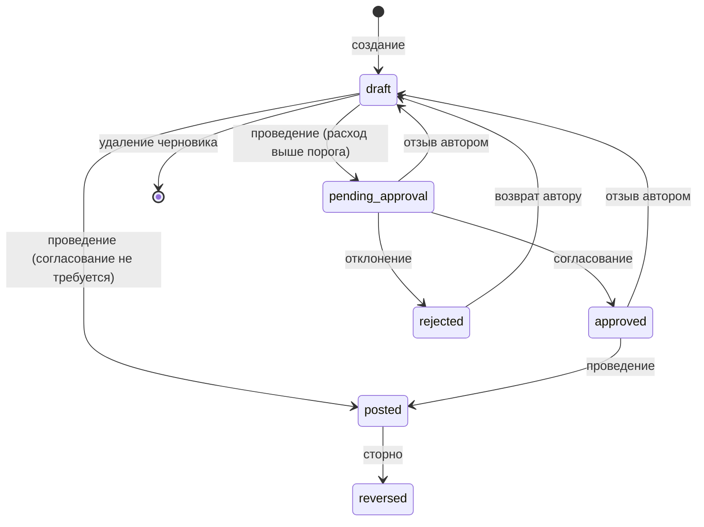
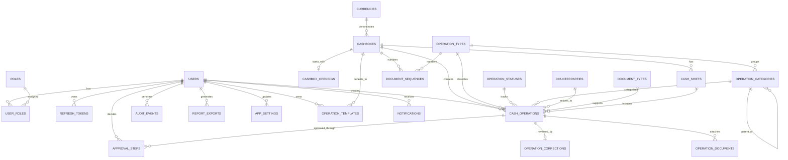

# Техническое задание на дипломный проект

## «Автоматизация регистрации и учета кассовых операций в бухгалтерии ООО „Фаиза“»

| Реквизит | Значение |
|---|---|
| **Автор** | Якубов Абдулло Вахидчонович |
| **ВУЗ / кафедра** | _указать_ |
| **Научный руководитель** | _указать_ |
| **Версия / дата** | 3.0 / 10 ноября 2026 г. |
| **Статус** | проект ТЗ для уточнения и согласования |
| **Согласовано** | ______________ (руководитель) «___» __________ 2026 г. |

---

## 1. Основание и стандарт оформления

Документ подготовлен как проект технического задания с разделами, характерными для ГОСТ 34 и IEEE 830: назначение, область применения, пользователи, требования, данные, интерфейсы, качество, проверка, развёртывание, этапы и риски. Перед официальной подачей структуру и обязательные формулировки необходимо сверить с методическими требованиями кафедры. Слова «должен», «обязан» обозначают обязательное требование; «может», «допускается» — необязательное.

## 2. Термины и определения

| Термин | Определение |
|---|---|
| Касса | Учётная единица, в которой ведётся остаток наличных в одной валюте. |
| Кассовая операция | Приход или расход наличных по кассе на календарную дату. |
| Черновик | Операция, сохранённая, но не влияющая на остаток. Допускает правку и удаление. |
| Проведение | Перевод операции в состояние «Проведена»: присваивается номер, операция начинает учитываться в остатке и становится неизменяемой. |
| Сторно | Новая проведённая операция противоположного типа на ту же сумму, ссылающаяся на оригинал; оригинал получает статус «Сторнирована». Основной способ исправления. |
| Кассовый день (смена) | Учётный период кассы за одну календарную дату. После закрытия проведение и сторно на эту дату запрещены. |
| ПКО / РКО | Приходный / расходный кассовый ордер — печатная форма операции (состав реквизитов уточняется). |
| Кассовая книга | Отчёт за кассовый день: остаток на начало, операции по номерам, итоги, остаток на конец. |
| Контрагент | Лицо или организация, указанная в реквизитах операции. Бизнес-процессы контрагента не реализуются. |
| Допущение | Принятое по умолчанию решение по сведению, которое не удалось подтвердить; подлежит согласованию. |

## 3. Анализ предметной области и допущения

### 3.1. Сведения об организации из открытых источников

Официальный сайт описывает ООО «Фаиза» как дистрибьюторскую компанию в Таджикистане, работающую с продуктами питания и зарубежными партнёрами; упоминаются отдел продаж, склады, транспорт и филиалы. Внешний поставщик GPS-решений опубликовал проект мониторинга транспорта и маршрутов для компании. Отраслевой материал о рынке дистрибуции называет компанию в написании «Файза» среди дистрибьюторов продуктов питания; написание «Файза» и «Фаиза» относится к одной организации (требует подтверждения у руководителя). Размер штата и число торговых точек в отраслевых материалах могут быть устаревшими.

Публичные источники не описывают кассовый регламент и внутренние информационные системы компании, поэтому утверждения о её конкретных документах и процессах в ТЗ не выдаются за установленные факты.

### 3.2. Граница проекта

Для дистрибьюторской компании типичны продажи, закупки, склад, доставка и дебиторская задолженность. Проект **охватывает только кассовые операции бухгалтерии**. Продажи, заказы, склад, закупки, доставка, GPS, CRM, HR и клиентский портал в предмет разработки не входят. Клиенты, поставщики и сотрудники присутствуют только как контрагенты в реквизитах операции.

### 3.3. Допущения по умолчанию

Разработка ведётся на следующих допущениях; изменение допущения не должно требовать переписывания архитектуры.

| № | Допущение (значение по умолчанию) | Кого уточнить |
|---|---|---|
| Д-1 | Основная валюта — TJS (сомони); система поддерживает несколько валют, одна касса — одна валюта, итоги разных валют не суммируются. | бухгалтер |
| Д-2 | В демонстрации одна основная касса; схема и API рассчитаны на несколько касс. | бухгалтер |
| Д-3 | Начальный остаток задаётся один раз на кассу на дату начала учёта; операции ранее этой даты запрещены. | руководитель |
| Д-4 | ПКО, РКО и кассовая книга реализуются как печатные формы с настраиваемым набором реквизитов. | бухгалтер, кафедра |
| Д-5 | Исправление проведённой записи выполняется сторно. Физическое удаление и правка проведённых операций запрещены. | бухгалтер |
| Д-6 | Согласование расходов по порогу суммы отключено по умолчанию и включается настройкой. | руководитель |
| Д-7 | Лимит остатка кассы — необязательная настройка; при превышении выводится предупреждение, проведение не блокируется. | бухгалтер |
| Д-8 | Интеграция с бухгалтерской программой не выполняется; обмен данными — CSV-экспорт. | руководитель |
| Д-9 | Дата и границы периодов считаются в часовом поясе Asia/Dushanbe (UTC+5). | — |
| Д-10 | Уведомления только внутри системы (без e-mail и SMS). | руководитель |

Для демонстрации используются вымышленные данные.

## 4. Назначение, цели, результат и приоритеты

### 4.1. Назначение

Система предназначена для автоматизации регистрации и учёта приходных и расходных кассовых операций, контроля остатка, закрытия кассовых дней, согласования крупных расходов, просмотра кассового журнала и формирования отчётов бухгалтерии.

### 4.2. Цели

- упорядочить регистрацию кассовых операций и исключить отрицательный остаток;
- сократить ручные расчёты остатка и подготовку ПКО/РКО и кассовой книги;
- быстро находить записи по дате, типу, документу и контрагенту;
- получать сводку прихода, расхода и остатка за период;
- обеспечить контролируемый доступ, согласование и неизменяемую историю действий.

### 4.3. Результат

Веб-приложение (frontend, backend API, PostgreSQL); схема данных и миграции; SQL демонстрационных данных; автотесты; Docker Compose; README; материалы для описания проекта в дипломе.

### 4.4. Приоритеты реализации (MoSCoW)

| Приоритет | Модули |
|---|---|
| **Must** (ядро) | 1 Авторизация, 2 Кассы, 3 Справочники, 4 Регистрация, 5 Проведение и сторно, 6 Журнал, 7 Остатки, 8 Отчёты и CSV, 10 Аудит |
| **Should** | 9 Панель сводки, 12 Обслуживание, резервирование и ночная сверка остатков, 13 Кассовые дни, печатные ПКО/РКО и кассовая книга |
| **Could** | 14 Согласование расходов, 15 Вложения, 16 Шаблоны повторяющихся операций, 17 Уведомления, 11 Импорт CSV, хэш-цепочка аудита, экспорт в Excel, таджикская локализация |

Модули Must реализуются первыми и должны образовывать работающую систему; остальные добавляются по этапам (раздел 14), не нарушая ядро.

## 5. Пользователи и права доступа

Роли (коды): `admin`, `accountant`, `manager`, `auditor`. Пользователь должен иметь активную учётную запись. Авторизация и проверка ролей выполняются сервером. Регистрация новых пользователей доступна только администратору.

| Действие | admin | accountant | manager | auditor |
|---|:-:|:-:|:-:|:-:|
| Пользователи, роли, настройки | ✓ | — | — | — |
| Кассы, начальные остатки, валюты | ✓ | — | — | — |
| Справочники (категории, контрагенты, типы документов) | ✓ | ✓ | — | — |
| Создание, правка, удаление черновиков | — | ✓ | — | — |
| Проведение операций | — | ✓ | — | — |
| Сторно | — | ✓ | — | — |
| Согласование / отклонение расходов | — | — | ✓ | — |
| Отзыв своей операции с согласования | — | ✓ | — | — |
| Закрытие кассового дня | — | ✓ | — | — |
| Открытие закрытого дня (с причиной, аудируется) | ✓ | — | — | — |
| Загрузка вложений | — | ✓ | — | — |
| Просмотр журнала, карточек, отчётов, печатных форм | ✓ | ✓ | ✓ | ✓ |
| Просмотр аудита | ✓ | — | ✓ | ✓ |
| Проверка целостности аудита | ✓ | — | — | ✓ |
| Импорт справочников и начальных остатков | ✓ | — | — | — |
| Шаблоны повторяющихся операций | — | ✓ | — | — |
| Собственные уведомления | ✓ | ✓ | ✓ | ✓ |

Администратор не создаёт и не проводит операции и не может изменять проведённые операции; его импорт затрагивает только справочники и начальные остатки. Согласующий не может согласовать операцию, созданную им самим (на практике создаёт только `accountant`).

## 6. Функциональные требования и модули

### Модуль 1. Авторизация и управление пользователями (Must)

- вход по логину и паролю; сообщение об ошибке не раскрывает, что именно неверно;
- JWT access token (срок жизни 15 минут) и refresh token (7 дней) с ротацией; refresh token передаётся в httpOnly Secure SameSite cookie, не хранится в localStorage;
- выход с отзывом refresh token; блокировка и разблокировка учётной записи администратором;
- пароль: не менее 10 символов, буквы и цифры; хэширование стойким алгоритмом (Argon2id, bcrypt либо PBKDF2 с достаточным числом итераций);
- защита от подбора: после 5 неудачных попыток за 15 минут с одного IP вход для этого логина с этого IP блокируется на 15 минут; для самого логина без привязки к IP действует только нарастающая задержка ответа. Учётная запись не блокируется чужими попытками, поэтому её нельзя вывести из строя намеренным подбором (журнал `login_attempts`, события видны администратору);
- смена пароля пользователем; сброс пароля администратором с принудительной сменой при входе;
- создание и изменение пользователя, назначение ролей — администратором;
- первый администратор создаётся при начальном развёртывании (seed или команда из README), пароль задаётся через переменные окружения;
- серверная проверка доступа для каждого защищённого метода API.

### Модуль 2. Кассы и настройки учёта (Must)

- создать кассу: код, название, валюта, статус, необязательный лимит остатка (Д-7);
- задать начальный остаток и дату начала учёта (одна запись на кассу, Д-3); изменять можно только до первой проведённой операции;
- несколько касс (Д-2); итоговые показатели всегда в разрезе валюты;
- запретить удаление кассы с операциями; допускается отключение;
- хранить настройки: формат номера документа, порог согласования, параметры отчётов.

### Модуль 3. Справочники кассового учёта (Must)

- категории прихода и расхода (иерархия, привязка к типу операции);
- контрагенты (название, налоговый код при наличии, контакт, вид: клиент, поставщик, сотрудник, прочее);
- типы документов-оснований;
- активность элементов, поиск; деактивация вместо удаления для используемых элементов;
- не создавать подсистемы продаж, поставок или управления клиентами.

### Модуль 4. Регистрация кассовых операций (Must)

- создать приходную или расходную запись: касса, дата, сумма, содержание, категория, тип документа-основания, контрагент;
- автоматически сохранять автора и время создания;
- валидация обязательных полей, положительной суммы, того, что дата операции не раньше даты начала учёта кассы;
- черновик можно изменять (`PATCH`) и удалять; параллельное изменение защищается версией строки (при конфликте — ответ 409);
- номер документа присваивается при проведении (раздел 7.3), не при создании черновика;
- понятные сообщения об ошибках.

### Модуль 5. Проведение, согласование и сторно (Must)

Жизненный цикл и правила описаны в разделе 7. Модуль обязан:

- проводить операцию в одной транзакции: проверка периода, проверка остатка, присвоение номера, смена статуса, запись аудита;
- создавать сторно с обязательной причиной и ссылкой на оригинал;
- не допускать правки и удаления проведённых и сторнированных операций;
- журналировать пользователя, время и основание каждой операции.

Приложение не заменяет утверждённые первичные документы; точный порядок исправления согласуется с руководителем (Д-5).

### Модуль 6. Журнал операций и поиск (Must)

- список операций, сортировка по дате и номеру;
- фильтры: касса, период, тип, статус, категория, контрагент, смена;
- поиск по номеру документа и тексту содержания;
- серверная пагинация;
- карточка операции: реквизиты, автор, время, история статусов, согласования, вложения, связанное сторно.

### Модуль 7. Остатки и кассовый контроль (Must)

- остаток = начальный остаток + проведённые приходы − проведённые расходы (сторно учитываются как обычные проведённые операции противоположного типа);
- остаток на любую дату; остаток до и после операции в учётном порядке (раздел 7.2);
- запрет проведения операции, после которой остаток **в любой точке учётной последовательности, начиная с этой операции**, становится отрицательным (раздел 7.2); расчёт опирается на контрольные точки закрытых дней;
- предупреждение при превышении лимита кассы (Д-7);
- защита от параллельного проведения блокировкой кассы в транзакции (раздел 7.4).

### Модуль 8. Кассовые отчёты (Must)

- сводка по кассе и периоду: остаток на начало и конец, суммы и количество приходов и расходов;
- детализация по дням, категориям, типам, контрагентам;
- **кассовая книга** за кассовый день (Д-4);
- **печатные формы ПКО и РКО** для проведённой операции (Д-4);
- печатный вид отчётов и экспорт CSV (UTF-8 с BOM, разделитель «;», защита от формульной инъекции: значения, начинающиеся с `=`, `+`, `-`, `@`, экранируются); экспорт в Excel (.xlsx) — необязательно;
- события экспорта записываются в `report_exports`.

### Модуль 9. Панель сводки (Should)

- текущий остаток по каждой кассе (в её валюте);
- приход и расход за период; динамика по дням и месяцам;
- переход от показателя к отфильтрованному журналу;
- предупреждения: превышен лимит, есть неподтверждённые операции, незакрытые прошлые дни;
- никаких KPI продаж, склада или доставки.

### Модуль 10. Журнал аудита (Must)

- регистрировать: входы и неудачные попытки (без паролей и токенов), создание, правку и удаление черновиков, отправку на согласование, согласование и отклонение, проведение, сторно, закрытие и открытие дня, действия с пользователями, кассами, настройками, импортом, экспортом;
- хранить пользователя, тип события, объект, идентификатор, время и безопасное описание изменения;
- фильтры по периоду, пользователю, объекту;
- журнал только добавляется: в интерфейсе и на уровне БД нет правки и удаления записей (раздел 7.5);
- (Could) защита от подмены: каждая запись хранит хэш предыдущей (`prev_hash`, `hash`), запись цепочки выполняется под блокировкой; метод проверки сообщает о первой нарушенной записи.

### Модуль 11. Импорт и демонстрационные данные (Could)

- демонстрационный набор загружается SQL-скриптом;
- генератор данных (команда или скрипт) создаёт контрольный объём (100 000 операций, 5 касс) для проверки производительности по разделу 8.3;
- импорт CSV (начальные данные, справочники) — только по отдельному согласованию;
- предпросмотр: проверка структуры, дублей и ошибок до подтверждения импорта; импорт атомарный;
- реальные персональные и финансовые данные не используются без разрешения.

### Модуль 12. Системное обслуживание и резервирование (Should)

- инструкции и скрипты резервного копирования и восстановления PostgreSQL (включая каталог вложений);
- конфигурация через переменные окружения, секреты не хранятся в Git;
- проверка доступности БД и статуса API (`/health`);
- ночная сверка (фоновое задание): пересчёт остатков по закрытым дням и сравнение с `closing_balance`, поиск пропусков в нумерации и (если включена) проверка хэш-цепочки аудита; результат записывается в аудит и создаёт уведомление администратору;
- миграции схемы при развёртывании.

### Модуль 13. Кассовые дни и закрытие периода (Should)

- кассовый день создаётся автоматически при первой проведённой операции на дату, имеет статус «Открыт» и привязывается к операциям (`cash_shift_id`); остаток на начало дня вычисляется как остаток на конец предыдущей даты (для первого дня — начальный остаток кассы);
- закрытие дня D выполняет `accountant`; оно закрывает и все более ранние даты кассы (даты без операций отдельной записи не требуют), поэтому дни без операций не блокируют закрытие; закрыть можно дату не позже текущей и не раньше даты начала учёта;
- при закрытии фиксируется расчётный остаток (`closing_balance`); фактический остаток по пересчёту вводится суммой либо по номиналам купюр и монет (`denominations`), расхождение вычисляется и попадает в отчёт и уведомление;
- закрыть день нельзя, пока на эту или более раннюю дату есть операции в статусах `draft`, `pending_approval`, `approved`: их сначала проводят, удаляют или переносят на открытую дату;
- после закрытия проведение и сторно на эту и более ранние даты запрещены; исправление закрытого дня выполняется сторно текущей датой;
- открытие закрытого дня — только `admin`, с обязательной причиной; событие попадает в аудит;
- отчёт «Кассовая книга» строится по закрытому или открытому дню.

### Модуль 14. Согласование расходов (Could)

- при включённой настройке порога (Д-6) расход с суммой выше порога (настройка `approval.expense_threshold.<КОД ВАЛЮТЫ>`) после команды «провести» переходит в статус «На согласовании»;
- `manager` согласует или отклоняет с комментарием (отклонение — комментарий обязателен); согласовать собственную операцию нельзя;
- после согласования `accountant` проводит операцию; проверки остатка и периода выполняются в момент проведения;
- отклонённая операция возвращается автору как черновик (команда `return-to-draft`) с видимым комментарием; автор может отозвать операцию из `pending_approval` или `approved` обратно в черновик (`recall`), история решений при этом сохраняется;
- история решений хранится в `approval_steps` и отображается в карточке.

### Модуль 15. Вложения (Could)

- к операции можно приложить скан или фото основания: PDF, JPG, PNG, не более 5 МБ, не более 5 файлов на операцию;
- проверяются реальный тип и размер файла; имя на диске формируется системой;
- к черновику вложения можно добавлять и удалять; к проведённой операции — только добавлять, удаление запрещено;
- файлы доступны только авторизованным пользователям через API (прямых публичных ссылок нет).

### Модуль 16. Шаблоны повторяющихся операций (Could)

- шаблон хранит кассу, тип, категорию, контрагента, содержание и необязательную сумму; создаётся с нуля или из существующей операции;
- команда «Создать черновик из шаблона» формирует черновик с текущей датой; необязательное расписание (еженедельно, ежемесячно) заставляет фоновое задание создавать **только черновики**, которые бухгалтер проверяет и проводит сам; автоматического проведения нет;
- повторный запуск задания за тот же период не создаёт дубликатов;
- шаблоны доступны `accountant`, у каждого шаблона есть владелец.

### Модуль 17. Уведомления (Could)

- уведомления внутри системы (Д-10): операция ожидает согласования (`manager`); операция согласована или отклонена (автор); превышен лимит кассы; расхождение при закрытии дня; результат ночной сверки (`admin`); есть незакрытые прошлые дни (`accountant`);
- счётчик непрочитанных в шапке, список, отметка «прочитано»; уведомление видит только адресат;
- уведомления не содержат паролей, токенов и лишних персональных данных.

## 7. Жизненный цикл операции и бизнес-правила

### 7.1. Статусы и переходы

Статусы (справочник `operation_statuses`): `draft` — черновик; `pending_approval` — на согласовании; `approved` — согласована; `rejected` — отклонена; `posted` — проведена; `reversed` — сторнирована.



- Редактировать и удалять можно только `draft` (и `rejected` после возврата в `draft`).
- `posted` и `reversed` необратимы; единственное допустимое изменение — смена `posted → reversed` при сторно и добавление вложений.
- Сторно создаёт новую операцию в статусе `posted` (признак `is_reversal`), оригинал получает `reversed`. Сторно сторно-операции и повторное сторно оригинала запрещены. Если нужна исправленная запись, бухгалтер создаёт новую операцию отдельно.
- Дата сторно по умолчанию текущая; дата оригинала допускается, если день не закрыт и проходит проверка 7.2. Сторно не может быть датировано раньше даты оригинала.
- Повторная команда (двойное нажатие, повтор запроса) не меняет результат: `post`, `approve`, `reversals` для операции, уже находящейся в целевом состоянии, возвращают 409 с текущим состоянием и ничего не дублируют.

### 7.2. Проверка остатка

Проведённые операции кассы образуют учётную последовательность, упорядоченную по `(operation_date, posting_seq)`; `posting_seq` — возрастающий по кассе номер, присваиваемый в момент проведения. Операция, проведённая задним числом, встаёт в конец своей даты (после ранее проведённых операций того же дня). При проведении (в том числе сторно) остаток пересчитывается по последовательности от места вставки и до конца, с учётом проводимой операции; если в любой точке он отрицателен, проведение отклоняется с указанием первой нарушенной точки. Расход нельзя провести раньше прихода, который его покрывает. Расчёт начинается с ближайшей контрольной точки — `closing_balance` последнего закрытого дня (модуль 13); без модуля 13 — с начального остатка кассы. Проверка выполняется в SQL (оконная сумма по проведённым операциям) внутри блокировки кассы.

### 7.3. Нумерация документов

Номер присваивается при проведении из счётчика `document_sequences` по ключу (касса, тип операции, год даты операции) под блокировкой строки счётчика в той же транзакции; откат транзакции откатывает и счётчик, поэтому номера не имеют пропусков. Формат задаётся настройкой, по умолчанию `{ПРЕФИКС}-{КОД КАССЫ}-{ГГГГ}-{000001}` (ПРЕФИКС: ПКО или РКО). Сторно-операция получает собственный номер по счётчику своего (противоположного) типа и печатается с пометкой «СТОРНО» и ссылкой на номер оригинала. Операция, проведённая задним числом в прошлый год, получает номер из счётчика того года.

### 7.4. Конкурентность

Проведение и сторно выполняются транзакцией: блокировка строки кассы (`SELECT … FOR UPDATE`), проверка периода, проверка остатка (7.2), присвоение номера (7.3) и `posting_seq`, привязка к кассовому дню, смена статуса, запись аудита, фиксация. Параллельные расходы по одной кассе выполняются последовательно. Правка черновиков защищена оптимистичной блокировкой по версии строки.

### 7.5. Неизменяемость на уровне БД

Помимо прикладных проверок, БД защищает данные: триггер запрещает `DELETE` и любые `UPDATE` операций в статусах `posted` и `reversed`, кроме единственного допустимого изменения — перевода `status_id` из `posted` в `reversed`; таблица `audit_events` доступна прикладной роли только на `INSERT` и `SELECT`.

### 7.6. Бизнес-правила

1. Сумма операции строго больше нуля.
2. Тип операции — «Приход» или «Расход».
3. У проведённой операции заполнены касса, дата, сумма, содержание, категория и присвоенный номер; реквизиты документа-основания обязательны в объёме, утверждённом кафедрой и бухгалтером.
4. В остатке учитываются только проведённые операции (включая сторно).
5. Остаток не может быть отрицательным ни в одной точке учётной последовательности (7.2).
6. Проведённая операция не удаляется и не меняется (7.5); исправление — только сторно.
7. Денежные суммы хранятся в `numeric(18,2)`, не в типах с плавающей точкой.
8. Дата операции не раньше даты начала учёта кассы и не позже текущей даты (будущие даты запрещены).
9. Нельзя проводить и сторнировать операции на закрытые даты (при реализованном модуле 13).
10. Все итоги формируются в разрезе валюты; суммирование разных валют запрещено.
11. Согласовать операцию может только пользователь, не являющийся её автором (модуль 14).
12. Отчёт строится по дате операции с явными границами периода и указанием кассы.
13. Каждое значимое действие записывается в аудит.
14. Кассу, у которой есть операции, нельзя удалить; справочные элементы с использованием — только деактивировать.
15. Повторная команда не создаёт двойного эффекта (7.1).
16. День нельзя закрыть, пока на его дату или более раннюю есть незавершённые операции (модуль 13).

## 8. Нефункциональные требования

### 8.1. Стек и архитектура

- Backend: C#, ASP.NET Core Web API (актуальная LTS-версия .NET на момент старта).
- ORM: Entity Framework Core; схема создаётся и меняется только миграциями.
- Frontend: JavaScript + React; API-клиент отделён от UI-компонентов.
- База данных: PostgreSQL.
- Контейнеризация: Docker и Docker Compose.
- Слои backend: Entities, DTO, Repositories, Services, Controllers, Middleware, Validation.
- Браузеры: актуальные версии Chrome, Edge, Firefox, Safari.

### 8.2. Безопасность

- TLS при удалённом развёртывании;
- JWT и ролевая авторизация на сервере; refresh token в httpOnly cookie;
- стойкое хэширование паролей, политика паролей, блокировка при подборе;
- серверная валидация, ограничение размера запросов и загружаемых файлов;
- безопасные заголовки; frontend и API публикуются с одного origin через обратный прокси (путь `/api`), поэтому cookie работает с `SameSite=Strict`, а CORS в production закрыт; защита от CSRF для запросов с cookie;
- защита экспортируемых файлов от формульной инъекции (модуль 8);
- секреты и строки подключения через `.env` или секрет-хранилище; в репозитории только `.env.example`;
- логи не содержат паролей, токенов и лишних персональных данных.

### 8.3. Производительность и надёжность

Проектная нагрузка первой версии — до 10 одновременных пользователей. Контрольный объём данных — 100 000 операций по 5 кассам:

- страница журнала (с фильтрами и пагинацией) — до 2 секунд;
- остаток на дату — до 1 секунды;
- отчёт за месяц — до 3 секунд;
- проведение операции (с проверкой по 7.2) — до 2 секунд.

Дополнительно: расчёт остатка опирается на контрольные точки закрытых дней (7.2); серверная пагинация; транзакционность проведения; ежедневное резервное копирование БД и каталога вложений, срок хранения согласуется; время событий хранится в UTC, дата операции — как календарная дата (границы по Asia/Dushanbe).

### 8.4. Сопровождение

- единый формат ошибок API (Problem Details);
- структурированные логи приложения;
- README: установка, запуск, создание администратора, резервное копирование и восстановление;
- миграции EF Core — единственный источник схемы; SQL-скрипты содержат только демонстрационные данные;
- разделение настроек разработки и production.

## 9. Схема БД (предварительная, 24 предметные таблицы)

Типы и поля уточняются при проектировании. Все PK/FK имеют ограничения целостности. Денежные значения — `numeric(18,2)`, моменты событий — `timestamptz`, даты операций — `date`. Служебная таблица истории миграций EF Core (`__EFMigrationsHistory`) в число предметных не входит.

| № | Таблица | Основные поля и ключи |
|---:|---|---|
| 1 | `users` | `id uuid PK`, `login UNIQUE`, `password_hash`, `full_name`, `is_active`, `must_change_password`, `locked_until nullable`, `created_at` |
| 2 | `roles` | `id smallserial PK`, `code UNIQUE` (admin, accountant, manager, auditor), `name` |
| 3 | `user_roles` | `user_id FK`, `role_id FK`, составной PK |
| 4 | `refresh_tokens` | `id uuid PK`, `user_id FK`, `token_hash`, `expires_at`, `revoked_at nullable`, `replaced_by nullable` |
| 5 | `login_attempts` | `id bigserial PK`, `login`, `ip_address`, `succeeded`, `created_at` |
| 6 | `currencies` | `id smallserial PK`, `code char(3) UNIQUE`, `name`, `minor_units` |
| 7 | `cashboxes` | `id bigserial PK`, `code UNIQUE`, `name`, `currency_id FK`, `balance_limit numeric(18,2) nullable`, `is_active` |
| 8 | `cashbox_openings` | `id bigserial PK`, `cashbox_id FK UNIQUE`, `effective_date date`, `amount numeric(18,2)`, `created_by FK`, `created_at` |
| 9 | `operation_types` | `id smallserial PK`, `code UNIQUE` (income, expense), `name`, `sign` (+1 / −1) |
| 10 | `operation_statuses` | `id smallserial PK`, `code UNIQUE` (draft, pending_approval, approved, rejected, posted, reversed), `name` |
| 11 | `operation_categories` | `id bigserial PK`, `parent_id FK nullable`, `operation_type_id FK`, `name`, `is_active` |
| 12 | `counterparties` | `id bigserial PK`, `name`, `kind`, `tax_code nullable`, `contact nullable`, `is_active` |
| 13 | `document_types` | `id smallserial PK`, `code UNIQUE`, `name`, `is_active` |
| 14 | `document_sequences` | `cashbox_id FK`, `operation_type_id FK`, `year smallint`, `last_number int`, составной PK |
| 15 | `cash_operations` | `id bigserial PK`, `cashbox_id FK`, `operation_type_id FK`, `status_id FK`, `category_id FK`, `counterparty_id FK nullable`, `document_type_id FK nullable`, `cash_shift_id FK nullable`, `operation_date date`, `amount numeric(18,2) CHECK >0`, `description NOT NULL`, `document_number nullable`, `document_year smallint nullable`, `is_reversal bool`, `created_by FK`, `created_at`, `updated_at`, `posted_by FK nullable`, `posted_at nullable`, `posting_seq bigint nullable`, `row_version` |
| 16 | `operation_documents` | `id bigserial PK`, `operation_id FK`, `file_name`, `storage_key`, `mime_type`, `size_bytes`, `uploaded_by FK`, `created_at` |
| 17 | `operation_corrections` | `id bigserial PK`, `original_operation_id FK UNIQUE`, `reversal_operation_id FK UNIQUE`, `reason NOT NULL`, `created_by FK`, `created_at` |
| 18 | `approval_steps` | `id bigserial PK`, `operation_id FK`, `approver_id FK`, `decision` (approved/rejected), `comment`, `decided_at` |
| 19 | `cash_shifts` | `id bigserial PK`, `cashbox_id FK`, `shift_date date`, `status` (open/closed), `opening_balance`, `closing_balance nullable`, `counted_amount nullable`, `denominations jsonb nullable`, `closed_by FK nullable`, `closed_at nullable`, `reopened_by FK nullable`, `reopen_reason nullable`, `UNIQUE (cashbox_id, shift_date)` |
| 20 | `audit_events` | `id bigserial PK`, `user_id FK nullable`, `action`, `entity`, `entity_id`, `details jsonb`, `prev_hash nullable`, `hash nullable`, `created_at` |
| 21 | `app_settings` | `key text PK`, `value jsonb`, `updated_by FK`, `updated_at` |
| 22 | `report_exports` | `id bigserial PK`, `user_id FK`, `report_code`, `parameters jsonb`, `created_at` |
| 23 | `operation_templates` | `id bigserial PK`, `owner_id FK`, `name`, `cashbox_id FK`, `operation_type_id FK`, `category_id FK`, `counterparty_id FK nullable`, `description`, `amount nullable`, `schedule` (none/weekly/monthly), `next_run_on date nullable`, `is_active` |
| 24 | `notifications` | `id bigserial PK`, `user_id FK`, `kind`, `payload jsonb`, `created_at`, `read_at nullable` |

**Индексы:** `users(login)` UNIQUE; `cash_operations(cashbox_id, operation_date, id)`; `cash_operations(cashbox_id, status_id, operation_date, posting_seq)`; UNIQUE `(cashbox_id, posting_seq)` для проведённых; `notifications(user_id, read_at)`; `cash_operations(status_id, operation_date)`; UNIQUE `(cashbox_id, operation_type_id, document_year, document_number)` для непустых номеров; `cash_operations(counterparty_id)`; `audit_events(created_at)` и `(entity, entity_id)`; `counterparties(name)`; `report_exports(user_id, created_at)`; `login_attempts(login, created_at)`.

**Ограничения:** сумма > 0; тип и статус ограничены справочниками; FK исключают осиротевшие записи; для проведённых операций `document_number`, `posted_by`, `posted_at`, `posting_seq` NOT NULL (проверяется триггером по статусу); `document_year` — год даты операции; триггеры неизменяемости (7.5); физическое удаление значимых записей ограничено.



Примечание: `login_attempts` связана с пользователем по значению `login`, а не по FK (попытки могут относиться к несуществующему логину).

## 10. API-эндпоинты

Формат JSON; ошибки — `application/problem+json`. Все методы требуют JWT, кроме `login`, `refresh` и `health`. Права соответствуют разделу 5; проверка выполняется на сервере.

| Метод и URL | Входные данные | Результат / доступ |
|---|---|---|
| `POST /api/auth/login` | `{login,password}` | access token, refresh cookie, данные пользователя |
| `POST /api/auth/refresh` | refresh cookie | новая пара токенов |
| `POST /api/auth/logout` | refresh cookie | отзыв токена |
| `GET /api/auth/me` | — | текущий пользователь и роли |
| `POST /api/auth/change-password` | old, new | смена пароля |
| `GET /api/users` | page, pageSize, q | пользователи; admin |
| `GET /api/users/{id}` | — | карточка; admin |
| `POST /api/users` | login, password, fullName, roleIds | создать; admin |
| `PATCH /api/users/{id}` | изменяемые поля, isActive | изменить, заблокировать; admin |
| `POST /api/users/{id}/reset-password` | — | временный пароль; admin |
| `GET /api/roles` | — | список ролей |
| `GET /api/currencies`, `POST /api/currencies` | code, name | чтение — все; создание — admin |
| `GET /api/cashboxes` | active | список касс |
| `GET /api/cashboxes/{id}` | — | карточка кассы |
| `POST /api/cashboxes` | code, name, currencyId, balanceLimit | создать; admin |
| `PATCH /api/cashboxes/{id}` | name, active, balanceLimit | обновить; admin |
| `PUT /api/cashboxes/{id}/opening` | effectiveDate, amount | начальный остаток; admin |
| `GET /api/cashboxes/{id}/balance` | date | остаток на дату |
| `GET/POST/PATCH /api/categories` | typeId, parentId, name, active | чтение — все; запись — admin, accountant |
| `GET/POST/PATCH /api/counterparties` | q, name, kind, taxCode | чтение — все; запись — admin, accountant |
| `GET/POST/PATCH /api/document-types` | code, name, active | чтение — все; запись — admin, accountant |
| `GET /api/operations` | from, to, cashboxId, typeId, statusId, categoryId, counterpartyId, q, sort, page, pageSize | страница журнала |
| `POST /api/operations` | касса, дата, тип, сумма, содержание, категория, документ, контрагент | создать черновик; accountant |
| `GET /api/operations/{id}` | — | карточка и история |
| `PATCH /api/operations/{id}` | поля, версия | изменить черновик; accountant |
| `DELETE /api/operations/{id}` | версия | удалить черновик; accountant |
| `POST /api/operations/{id}/post` | — | провести (или отправить на согласование); accountant |
| `POST /api/operations/{id}/approve` | comment | согласовать; manager |
| `POST /api/operations/{id}/reject` | comment (обязателен) | отклонить; manager |
| `POST /api/operations/{id}/return-to-draft` | — | вернуть отклонённую в черновик; автор |
| `POST /api/operations/{id}/recall` | — | отозвать с согласования в черновик; автор |
| `POST /api/operations/{id}/reversals` | reason, date | сторно; accountant |
| `GET /api/operations/{id}/attachments` | — | список вложений |
| `POST /api/operations/{id}/attachments` | файл | загрузить; accountant |
| `GET /api/attachments/{id}` | — | скачать |
| `DELETE /api/attachments/{id}` | — | удалить вложение черновика; accountant |
| `GET /api/operations/{id}/print` | — | печатная форма ПКО/РКО |
| `GET /api/shifts` | cashboxId, from, to | кассовые дни |
| `POST /api/shifts/close` | cashboxId, date, countedAmount | закрыть день; accountant |
| `POST /api/shifts/{id}/reopen` | reason | открыть день; admin |
| `GET /api/summary` | from, to, cashboxId | остатки и итоги |
| `GET /api/reports/cash` | from, to, cashboxId, groupBy | детальный отчёт |
| `GET /api/reports/cash.csv` | те же фильтры | CSV-файл (с защитой от формульной инъекции) |
| `GET /api/reports/cash.xlsx` | те же фильтры | Excel-файл (необязательно) |
| `GET /api/reports/cash-book` | cashboxId, date | кассовая книга |
| `POST /api/import/preview` | type (categories, counterparties, openings), CSV | проверка без записи; admin |
| `POST /api/import/commit` | токен предпросмотра | импорт; admin |
| `GET /api/audit` | from, to, userId, entity, page | аудит; admin, manager, auditor |
| `GET /api/audit/verify` | from, to | проверка хэш-цепочки; admin, auditor |
| `GET /api/settings`, `PUT /api/settings` | key, value | настройки; admin |
| `GET/POST/PATCH/DELETE /api/templates` | поля шаблона, schedule | шаблоны; accountant |
| `POST /api/templates/{id}/create-draft` | — | создать черновик из шаблона; accountant |
| `GET /api/notifications` | unreadOnly, page | свои уведомления |
| `POST /api/notifications/{id}/read` | — | отметить прочитанным |
| `GET /health` | — | статус API и БД |

## 11. Интерфейс и экраны

1. **Вход:** логин, пароль, сообщения об ошибке и блокировке.
2. **Сводка:** период, касса, остаток, приход и расход, график, предупреждения.
3. **Журнал:** таблица, фильтры, поиск, сортировка, пагинация, добавление.
4. **Форма операции:** тип, касса, дата, сумма, категория, основание, контрагент, комментарий, вложения.
5. **Карточка операции:** реквизиты, статус, автор, история и согласования, вложения, действия по роли.
6. **Сторно:** связь с оригиналом, причина, подтверждение.
7. **Согласование:** очередь операций на согласовании для `manager`.
8. **Кассовые дни:** список дней, закрытие, ввод пересчёта по номиналам, расхождение.
9. **Отчёты:** параметры, итоги, детализация, кассовая книга, ПКО/РКО, печать и CSV.
10. **Кассы и остатки:** список касс, валюта, начальный остаток, лимит.
11. **Справочники:** категории, контрагенты, типы документов.
12. **Пользователи и роли:** администратору.
13. **Аудит и настройки:** журнал событий, проверка целостности, параметры системы.
14. **Шаблоны:** список шаблонов, создание черновика, расписание.
15. **Уведомления:** список и счётчик непрочитанных в шапке.

Интерфейс адаптируется для настольного экрана и планшета; формат даты и валюты настраиваются. Русский язык обязателен; таджикская локализация — дополнительный этап (Could).

## 12. Тестирование и критерии приёмки

### 12.1. Виды проверок

- модульные тесты Domain и Application (xUnit): правила остатка, сторно, нумерация, переходы статусов; покрытие строк не менее 70% для этих слоёв;
- интеграционные тесты API на реальном PostgreSQL (контейнер): авторизация, права по ролям, транзакции, триггеры неизменяемости;
- тесты frontend (формы, валидация, права в интерфейсе);
- ручные сценарии приёмки (12.2).

### 12.2. Основные сценарии

- вход, неверный пароль, ограничение после 5 неудачных попыток с одного IP, учётная запись не блокируется чужими попытками, заблокированный администратором пользователь;
- доступ и запрет каждого метода для каждой роли (матрица раздела 5);
- создание прихода, черновика расхода, правка и удаление черновика, проведение;
- отказ при сумме ≤ 0, при отсутствии обязательных полей, при дате позже текущей или раньше начала учёта;
- отказ при недостаточном остатке, **включая проведение задним числом, которое делает отрицательным остаток на более поздней дате**;
- параллельное проведение двух расходов по одной кассе: не более одного проходит при недостатке средств;
- сторно прихода, из-за которого остаток уходит в минус, — отказ; повторное сторно — отказ;
- номера документов без пропусков и дублей (в том числе при ошибке в транзакции);
- согласование: расход выше порога, отклонение, самосогласование запрещено;
- закрытие дня, запрет проведения в закрытый день, открытие администратором с причиной;
- попытка обновить или удалить проведённую операцию напрямую в БД — отклоняется триггером;
- вложения: допустимый и недопустимый тип, размер, запрет удаления у проведённой операции;
- верный остаток на дату и итоги периода в разрезе валют;
- поиск, фильтры, пагинация; экспорт CSV и кассовая книга с верным периодом и итогами;
- порядок внутри дня: расход не проводится раньше покрывающего его прихода; проведение задним числом встаёт в конец своей даты;
- двойное нажатие «провести» и повтор запроса не создают двойного проведения (409);
- закрытие дня с незавершёнными операциями — отказ; закрытие дня после дней без операций проходит;
- отзыв с согласования и возврат отклонённой операции;
- экспорт CSV: значения, начинающиеся с `=`, `+`, `-`, `@`, экранированы;
- хэш-цепочка аудита: ручная подмена записи обнаруживается проверкой (если включена);
- ночная сверка выявляет искусственно внесённое расхождение остатка;
- шаблоны: повторный запуск расписания не создаёт дубликатов черновиков;
- уведомления видит только адресат;
- резервное копирование и восстановление по инструкции.

### 12.3. Критерии приёмки

- данные сохраняются в PostgreSQL и доступны после перезапуска;
- остатки соответствуют формуле и учитывают только проведённые операции;
- остаток не бывает отрицательным ни в одной точке учётной последовательности;
- проведённая операция не исчезает и не меняется ни через API, ни напрямую в БД;
- запрет доступа проверяется сервером, а не только скрытием кнопок;
- показатели производительности раздела 8.3 выполнены на контрольном объёме данных;
- отчёты и CSV соответствуют фильтрам;
- проект запускается по README командой Docker Compose с демонстрационными данными;
- автотесты проходят, покрытие не ниже заданного.

## 13. Развёртывание и состав проекта

```text
Backend/
  FaizaCash.Api/             Controllers, Middleware
  FaizaCash.Application/     DTO, Validators, Services
  FaizaCash.Domain/          Entities, enums, rules
  FaizaCash.Infrastructure/  EF Core, repositories, migrations
  Tests/
    FaizaCash.UnitTests/
    FaizaCash.IntegrationTests/
Frontend/
  src/pages/                 страницы
  src/components/            компоненты
  src/api/                   клиент API
  src/forms/                 формы и валидация
Database/
  scripts/                   SQL демонстрационных данных, скрипты резервного копирования
docker-compose.yml
.env.example
README.md
```

Docker Compose запускает три сервиса: PostgreSQL, API и web (статическая сборка React; он же обратный прокси: `/` — frontend, `/api` — API), а также тома для данных БД и вложений. Фоновые задания (ночная сверка, черновики из шаблонов) выполняются в процессе API как hosted services; повторный запуск безопасен. Переменные окружения задают пароль БД, строку подключения, JWT secret, параметры первого администратора и среды. Схема создаётся миграциями EF Core; SQL-скрипты содержат только демонстрационные данные. README описывает установку Docker, запуск, создание администратора, резервное копирование и восстановление.

## 14. Этапы разработки

1. Согласование ТЗ, допущений Д-1…Д-9, кассовых документов, правил исправления и закрытия дня.
2. Модель данных PostgreSQL, миграции, справочники, триггеры неизменяемости.
3. **Must:** backend касс, справочников и операций (Entity, DTO, Repository, Service, Controller, валидация, ошибки), правило остатка и сторно, нумерация, транзакции.
4. **Must:** авторизация, роли, аудит; интеграционные тесты прав и остатков.
5. **Must:** frontend: вход, форма, журнал, фильтры, пагинация, карточка, сторно.
6. **Must:** отчёты и CSV; сводка.
7. **Should:** кассовые дни, кассовая книга, ПКО/РКО, панель сводки, резервное копирование.
8. **Could:** согласование расходов, вложения, шаблоны, уведомления, хэш-цепочка аудита, импорт CSV, экспорт в Excel, локализация.
9. Docker Compose, README, демонстрационные данные, финальная проверка по сценариям, материалы дипломной работы.

Разработка ведётся последовательно по модулям с просмотром результата перед переходом к следующему.

## 15. Риски

| Риск | Мера |
|---|---|
| Требования бухгалтерии (формы, порядок исправлений) отличаются от допущений | Допущения Д-1…Д-9 изолированы настройками; согласование до этапа 3 |
| Объём проекта превышает доступное время | Приоритеты MoSCoW: ядро Must завершается первым |
| Ошибки в расчёте остатка и конкурентности | Проверка в SQL под блокировкой; интеграционные тесты на реальной БД |
| Утечка секретов и данных | `.env` вне Git, политика паролей, TLS, аудит |
| Потеря данных | Ежедневный бэкап БД и вложений, проверенная инструкция восстановления |
| Использование реальных данных компании | Только вымышленные демонстрационные данные |
| Медленный расчёт остатка при росте данных | Контрольные точки закрытых дней, составные индексы, генератор 100 000 операций и замеры по 8.3 |
| Намеренная блокировка чужих учётных записей подбором пароля | Ограничение по паре «логин + IP», нарастающая задержка, без блокировки аккаунта |
| Двойное проведение при повторном запросе | Проверка состояния в транзакции, ответ 409 |

## 16. Источники

- [Официальный сайт ООО «Фаиза»](https://faiza.tj/) — описание компании и партнёров.
- [Публичный GPS-кейс ООО «Фаиза»](https://info.gps.tj/) — опубликованное описание мониторинга маршрутов/посещений.
- [Исследование дистрибьюторского рынка Таджикистана](https://iutet.tj/wp-content/uploads/2024/05/%D0%94%D0%B8%D1%81%D1%81%D0%B5%D1%80%D1%82%D0%B0%D1%86%D0%B8%D1%8F-%D0%A5%D1%83%D0%B4%D0%BE%D0%B5%D1%80%D0%BE%D0%B2%D0%B0-%D0%A8.%D0%A5.-%D0%B1%D0%B0%D1%80%D0%BE%D0%B8-%D1%81%D0%B0%D0%B9%D1%82.pdf) — справочно: работа другого автора, используется только как отраслевой фон.

**Ограничение источников:** публичные данные не описывают кассовый регламент и внутреннюю IT-архитектуру ООО «Фаиза». Утверждения о конкретных формах и процессах компании в настоящем ТЗ не выдаются за установленные факты.

## Приложение А. История изменений

| Версия | Изменения |
|---|---|
| 1.0 | Первый проект ТЗ. |
| 3.0 | Исправлены дефекты версии 2.0: порядок проверки остатка внутри дня (`posting_seq`), закрытие дней без операций, незавершённые операции при закрытии дня, отзыв и возврат операций, дата сторно, идемпотентность команд, блокировка чужих аккаунтов при подборе пароля, формульная инъекция в CSV, cookie и origin, противоречие про импорт операций администратором. Добавлены модули 16 (шаблоны) и 17 (уведомления), хэш-цепочка аудита, ночная сверка, пересчёт по номиналам, генератор данных, экспорт в Excel; таблиц 24. |
| 2.0 | Добавлены глоссарий, допущения по умолчанию, приоритеты MoSCoW, матрица прав. Определены статусы и диаграмма переходов. Правило остатка расширено на будущие даты и сторно. Добавлены модули кассовых дней, согласования и вложений, нумерация документов, защита неизменяемости на уровне БД, ПКО/РКО и кассовая книга. Схема БД обновлена (22 таблицы, новые поля и ограничения), API расширен, ER-диаграмма сверена с таблицами. Уточнены требования к аутентификации, тестированию и производительности. |

## Приложение Б. Идеи развития (вне обязательной части)

| Идея | Польза | Трудоёмкость |
|---|---|---|
| Выдача под отчёт и авансовые отчёты (подотчётные лица, контроль закрытия) | высокая для дистрибьютора: торговые представители и водители | высокая |
| QR-код на ПКО/РКО для проверки подлинности документа в системе | средняя | низкая |
| Жёсткий лимит кассы (блокировка вместо предупреждения) | средняя | низкая |
| Мобильный режим (PWA) для согласования и просмотра остатка | средняя | средняя |
| Многофилиальность: привязка касс и пользователей к филиалу | высокая при росте | средняя |
| Экспорт проводок и импорт справочников для учётной программы (при её выборе) | высокая | средняя |
| Электронная подпись согласования | средняя | высокая |
| Таджикская локализация интерфейса и печатных форм | средняя | средняя |
