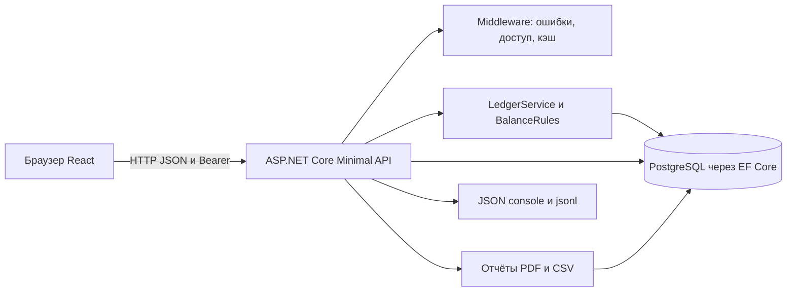
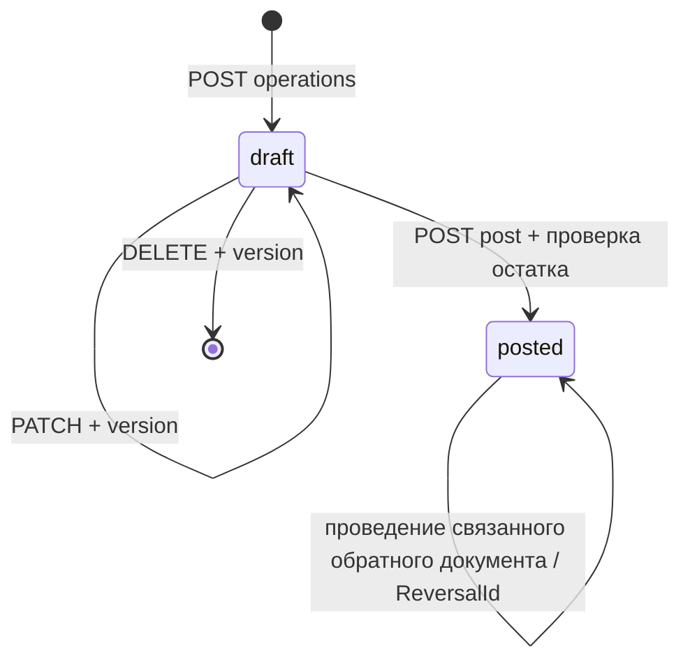

# Техническое задание Faiza Cash — редакция 4.0

## 1. Паспорт и правила чтения

Тема: «Автоматизация регистрации и учёта кассовых операций в бухгалтерии ООО „Фаиза“». Дата обследования: **13 ноября 2026 г., Asia/Dushanbe**. Статус: **проект актуализированной документации, не утверждён**. Версия 4.0 относится к документу, а не к релизу приложения; frontend/package.json содержит 1.0.0.

Основание — обследование локальных исходников, схемы EF Core, интерфейса, инфраструктуры и существующих тестов. Исследована ветка `main`, HEAD `b9710f328743ccae9a22bac33d93c9b01b40cf2e`, **с существенными незакоммиченными изменениями**. Этот commit сам по себе не описывает обследованную систему: действующие backend/frontend ещё не включены в него. Чужие правки не сбрасывались.

Исходник [ТЗ с именем v1.1](docs/archive/ТЗ_диплом_Фаиза_v1.1_как_получено.md) фактически имеет паспорт «3.0 / 10 ноября 2026» и историю 1.0–3.0. Отдельная достоверная редакция 1.1 не найдена. Здесь «старое ТЗ» означает именно предоставленный файл; историческая редакция 1.1 по одному имени не реконструируется. Поэтому следующая редакция документа обозначена 4.0. Содержимое исходника сохранено без изменения; единственная историческая копия — [архив](docs/archive/ТЗ_диплом_Фаиза_v1.1_как_получено.md). Дублирующий файл старого ТЗ в корне удалён при последующей очистке проекта; сравнение выполняется с архивом. Новая редакция — единственная актуальная точка входа, указанная в README.

В документе различаются состояния:

- **Реализовано, проверено тестом** — только поведение, непосредственно покрытое выполненными 13.11.2026 проверками.
- **Код есть, работоспособность не проверена** — цепочка найдена в исходниках, но актуальный HTTP/БД/браузерный сценарий не запускался.
- **Частично** — есть часть сценария, а остальные элементы явно перечислены как отсутствующие.
- **Реализация не найдена** — старое требование сохраняется как незакрытое, его отмена не предполагается.
- **Противоречит реализации** — фактическое правило отличается от старого.
- **Предложение** — не согласованное обязательство и не реализованная возможность.

Слова «должен» в критериях означают наблюдаемое ожидаемое поведение для проверки. Наличие критерия не означает успешную приёмку. Все пути ниже относительны корню faiza-cash; точные ссылки на доказательства собраны в [реестре](docs/srs-evidence.md). Подробное сопоставление каждой маркированной позиции, правил и контрактов старого ТЗ — [сравнение](docs/srs-comparison.md).

## 2. Назначение и границы

Система ведёт учебный кассовый журнал: приходные и расходные документы, черновики, проведение, связанное исправление, остатки, отчёты, справочники, пользователей и аудит. Цель — единая история денежных движений с проверкой неотрицательного остатка и серверным разграничением доступа.

Продажи, склад, доставка, закупочные процессы, GPS, CRM, HR, банковские платежи, электронная подпись и интеграция с бухгалтерской программой не реализуются. Контрагент — реквизит документа. Соответствие официальным формам и нормативным требованиям бухгалтерского учёта не установлено. Публичные сведения об организации из старого документа не перепроверялись и не используются как доказательство внутреннего регламента.

Обследованы локальные `backend`, `frontend`, `scripts`, `tests`, `docs`, Docker и примеры настроек. Недоступные внешние репозитории не предполагаются исследованными. Production, текущая рабочая БД и реальные пользовательские записи не обследовались. Секретные `.env` и `.runtime/local.json` не читались. Полноценный аудит безопасности, нагрузочное испытание и визуальная приёмка не выполнялись.

## 3. Термины, роли и права

**Касса** — набор операций в валюте организации. **Черновик (`draft`)** не меняет остаток. **Проведение (`posted`)** присваивает номер и очередь проведения, меняет остаток. **Сторно** — обратный черновик с причиной и `ReversalOfId`; только его проведение изменяет остаток и устанавливает у оригинала `ReversalId`. Оригинал остаётся `posted`. **Кассовая книга** — учебный отчёт всех проведённых движений выбранной кассы за включительный период. **Доступ к кассе** — запись `CashAccess`, отдельная от роли. **Версия** — `Version` черновика для проверки конкурирующих изменений.

Фактическая матрица API (при активном пользователе, после обязательной смены пароля):

| Действие | admin | accountant | cashier | manager / auditor |
|---|---|---|---|---|
| Читать назначенные кассы, операции, отчёты, PDF | Все кассы | Да | Да | Да |
| Создать черновик | Да | Да | Да | Нет |
| Править, удалить, провести черновик | Любой | Любой в доступной кассе | Только свой в доступной кассе | Нет |
| Создать сторно | Да | Да, доступная касса | Нет | Нет |
| Создать/изменить категории и контрагентов; создать тип основания | Да | Да | Нет | Нет |
| Создать/изменить кассу, менять организацию | Да | Нет | Нет | Нет |
| Пользователи, роли, выдача доступа | Да | Нет | Нет | Нет |
| Читать аудит и его справочники | Да | Да | Нет | Да |
| Читать организацию, роли, валюты, менять свой пароль | Да | Да | Да | Да |

Источник: `ApiEndpoints`, `DirectoryEndpoints`, `AuditEndpoints`, `AccessMiddleware`, `App`, `OperationDialog`. Роли объединяются: пользователь может иметь несколько. Admin обходит проверку назначения кассы. Не-admin должен иметь `CashAccess`; журнал без `cashboxId` для него возвращает 400. Аудит **общий для организации**, включая accountant; индивидуальный доступ к кассам его не ограничивает. Общие справочники и `/audit/options` не являются справочниками только своей кассы.

Manager/auditor создаются seed-кодом и поддерживаются API; UI нового пользователя предлагает admin/accountant/cashier. Уже назначенная manager/auditor отображается в форме редактирования. Очереди согласования для manager нет. Правило старого ТЗ «администратор не проводит операции» не соблюдается текущей реализацией; это зафиксированное расхождение, требующее решения владельца.

## 4. Архитектура и взаимодействие

Четыре C# проекта: Domain — сущности и Money; Application — DTO, BalanceRules и интерфейсы; Infrastructure — CashDb, миграции, LedgerService, identity, PDF, логирование; Api — DI, Minimal API и middleware. Многие CRUD выполняют EF-запросы прямо в endpoint; отдельного repository/validator слоя нет. React/Vite — JavaScript, Recharts и lucide-react. Отдельного сервиса очередей, планировщика, почтового или файлового хранилища нет.

В разработке Vite проксирует `/api` на локальный сервер. В Compose nginx отдаёт SPA и проксирует `/api` в API; PostgreSQL хранится в volume `postgres-data-v2`. `/health` проверяет подключение БД, в Vite нет отдельного proxy для него. Зависимость Google Fonts используется для Manrope с системным fallback, не для бизнес-логики.

## 5. Карта проекта

- `backend/src/FaizaCash.Api/Program.cs` — старт, настройка middleware и применение миграций; `Controllers/*Endpoints.cs` — маршруты.
- `backend/src/FaizaCash.Application/DTOs` — входные и выходные контракты; `Services/BalanceRules.cs` — расчёт допустимости проведения.
- `backend/src/FaizaCash.Domain/Entities/Models.cs` — 17 сущностей; `ValueObjects/Money.cs` — денежные ограничения.
- `backend/src/FaizaCash.Infrastructure/Persistence`, `Migrations`, `Services`, `Identity`, `Logging` — хранение и инфраструктура.
- `frontend/src/main.jsx`, `app/App.jsx` — вход и каркас; `pages`, `components`, `hooks`, `services`, `utils`, `styles` — интерфейс и клиент.
- `backend/tests`, `frontend/tests`, `tests` — unit, клиентские, API integration/security проверки.
- `scripts` — настройка локальной БД, запуск, учебное наполнение и проверка восстановления; `docs` — пояснения и прежние отчёты.

Полный перечень файлов, назначение, уровень просмотра и исключения — [реестр исследования](docs/srs-evidence.md). Старый `src/FaizaCash.Api` удалён в незакоммиченном состоянии и не является действующим backend.

## 6. Сценарии по ролям

Администратор входит, меняет первоначальный пароль, создаёт кассу, категории и пользователей, назначает доступ. Начальный остаток в обычном UI создаёт приходным документом и проводит. Администратор также может выполнять финансовые действия; запрета разделения обязанностей в коде нет.

Бухгалтер выбирает доступную кассу, создаёт и проверяет черновик, проводит приход/расход; при ошибке создаёт обратный черновик с причиной и отдельно проводит его. Может исправлять чужие черновики доступной кассы, архивировать справочники, читать общий аудит и выгружать отчёты.

Кассир работает со своими черновиками назначенных касс, проводит их и читает документы/отчёты этих касс. Чужие документы доступны на чтение в назначенной кассе, но не на изменение/проведение. Сторно и аудит недоступны. Manager/auditor читают назначенные кассы, отчёты и общий аудит; согласование не выполняют.

Цепочка создания: кнопка «Новый приход/расход» → `OperationDialog` → `api('/operations')` → JWT/AccessMiddleware → `Validate` → `CashDb.SaveChangesAsync` → запись draft и аудит → 201 → карточка документа. Проведение: подтверждение в карточке → POST `/{id}/post` → роли/касса → `LedgerService.Post` → транзакция и блокировка кассы → `BalanceRules` → номер/posted/аудит → 200 → повторная загрузка карточки и данных страницы. Отчёт: выбранные касса/период → ReportEndpoints → доступ → проведённые записи → остатки/страница или файл → ReportsPage/скачивание. Эти полные цепочки прослежены статически; браузерный и актуальный HTTP-прогон не заявляются выполненными.

## 7. Функциональные требования

Для FC-01…FC-12 ограничение проверки общее: исходники и сборка подтверждены; текущая работоспособность API/БД не проверена. Исключения — явно отмеченные unit и клиентские проверки. Номера проверок V-01…V-07 определены в разделе 17.

### FC-01. Аутентификация и сеанс

Назначение/роль: вход всех сотрудников. Вход: `login`, `password`, активная учётная запись. Логин нормализуется trim/lowercase. Успех возвращает accessToken, expiresIn=900 и безопасный UserDto, устанавливает refresh cookie. JWT хранится в памяти модуля клиента; refresh — HttpOnly, SameSite=Strict, Path=/api/auth, 7 дней; Secure зависит от фактического HTTPS запроса. На 401 защищённого запроса клиент выполняет единый общий refresh и повторяет запрос один раз. При загрузке SPA сеанс восстанавливается через refresh.

Ошибки/границы: неверный логин/пароль — общее сообщение 401; пять неуспешных попыток пары login+IP за последние 15 минут — 429; общий лимит 15 login-запросов/IP/минуту. Задержка использует счётчик той же пары, отдельной глобальной задержки по логину нет. Refresh ротируется; reuse отозванного токена отзывает все активные refresh данного пользователя. Logout отзывает переданный refresh, access действует до истечения (допуск проверки времени 20 секунд). Снятие роли/отключение проверяется по БД на каждом аутентифицированном запросе.

Данные: Users, UserRoles, RefreshTokens, LoginAttempts, AuditEvents. Источники: ApiEndpoints, IdentityServices, RequestMiddleware, AccessMiddleware, services/api.js. Состояние: код есть; объединение refresh и сохранение ошибок проверены V-03. Критерии: корректный вход выдаёт UserDto без хеша; два параллельных 401 вызывают один refresh; reuse делает successor недействительным; чужой Origin и отсутствие защитного заголовка при cookie отклоняются. HTTP-критерии остаются для изолированного прогона V-04/V-05.

### FC-02. Пользователи и пароль

Назначение/роль: admin управляет пользователями, все меняют собственный пароль. Предусловия: активная сессия, для администрирования роль admin. Создание: login, fullName, password, непустой массив строковых roles, mustChangePassword (по умолчанию true). PATCH меняет fullName, active, roles. Нельзя отключить себя либо убрать у себя admin. Дубли нормализованного логина — 409; неизвестные/пустые роли — 400. Нет публичной регистрации и сброса пароля администратором.

Пароль минимум 10 символов, буквы и цифры; PBKDF2-SHA512, 600000 итераций, соль 16 байт, ключ 32 байта, сравнение fixed time. Смена требует oldPassword/newPassword, отзывает активные refresh, снимает mustChangePassword. Обязательная смена блокирует все не-auth маршруты. Первый admin создаётся seed при отсутствии пользователей и допустимом Seed:AdminPassword, затем требует смену пароля.

Данные: Users, Roles, UserRoles и аудит. Источники: ApiEndpoints, IdentityServices, UserDto, UsersPage, contracts.js. Состояние: код есть, контракт и SSR таблицы проверены V-03. Критерии: таблица выдерживает пустые роли/пустую страницу, некорректный ответ становится понятной ошибкой; PATCH ролей сохраняет читаемый аудит; чужой не-admin получает 403. Полная HTTP-проверка — V-05.

### FC-03. Кассы, валюта, организация и доступ

Назначение: admin создаёт и архивирует кассы, выдаёт пользователям доступ; остальные читают назначенные. Вход кассы: code (ASCII буквы/цифры/дефис, до 24), name (до 160), currencyId валюты организации, balanceLimit nullable и неотрицательный. Код сохраняется в верхнем регистре, дубли — 409. PATCH меняет name/active/неотрицательный balanceLimit. Удаления кассы и отзыва CashAccess через API нет; повтор выдачи доступа безопасно возвращает 204.

Организация: name/currency, смена валюты запрещена при наличии любых операций. API допускает один трёхбуквенный код валюты, UI фиксирует TJS; многовалютный учёт отсутствует. TimeZone хранится, но UI/правила используют Asia/Dushanbe непосредственно. Openings есть в модели, но endpoint ввода отсутствует: новый UI начинает с нуля и приходного документа.

Данные: Cashboxes, Currencies, Organizations, CashAccess; источники ApiEndpoints/AccessMiddleware/App/CashCard. Состояние: частично относительно старого ТЗ, код API не проверен HTTP. Критерии: не-admin без назначения не получает кассу и её документы даже по id; назначение открывает чтение; manager не создаёт кассу; admin не может сменить валюту после появления документов. Лимит сохраняется через API, предупреждение превышения не реализовано.

### FC-04. Справочники

Назначение/роль: admin/accountant создают и архивируют категории/контрагентов; все читают. Категория: name до 160 после нормализации пробелов, type income/expense, parentId optional того же типа. Контрагент: name, kind client/supplier/employee/other, taxCode до 40, contact до 160. PATCH меняет лишь name/active; изменение вида и реквизитов контрагента не поддерживается. Дубли имён без учёта регистра и повторных пробелов сериализуются advisory lock и дают 409. Дубликат категории учитывает направление.

Архивные ссылки остаются в прежних операциях; новая операция не принимает архивный элемент. Старый черновик может сохранить прежнюю архивную категорию своего типа/контрагента. Тип основания: только GET/POST, без PATCH/UI-раздела; его ввод в форме операции отсутствует. Дерево категорий UI не отображает.

Данные: Categories, Counterparties, DocumentTypes, аудит автоматических изменений. Источники: DirectoryEndpoints, ApiEndpoints.Validate, OperationDialog. Состояние: частично; HTTP непроверен. Критерии: нормализованный дубль → 409; архив не обрывает старую ссылку; новые ссылки на архив → 400; cashier → 403 на запись. Воспроизводящие сценарии находятся в tests/review-cases.mjs.

### FC-05. Создание, изменение и удаление черновика

Назначение: admin/accountant/cashier регистрируют документы. Предусловие: активная доступная касса и категория нужного направления. Вход: cashboxId, date, type, amount, description, categoryId; counterpartyId/documentTypeId optional; requestKey — непустой UUID. Сумма >0, <=9999999999999999.99, максимум два десятичных знака; date не MinValue и не в будущем, не раньше Opening.Date при наличии; description непустое, <=1000. Автор/время проставляются сервером, номер пока отсутствует.

POST создаёт draft с Version=1 (201). Повтор ключа автора с совпадающими сравниваемыми полями возвращает ту же запись (200), другой payload — 409. Особенность: documentTypeId в сравнении повторного payload отсутствует; полная идемпотентность всех реквизитов не гарантируется. PATCH требует актуальный version, повышает его; DELETE требует `?version=` и физически удаляет draft. Admin/accountant могут менять чужие черновики, cashier — свои. ClearCounterparty=true очищает контрагента; null/пропуск без флага сохраняет прежнее значение. Тип основания очистить таким способом нельзя.

Данные: Operations, связанные справочники, AuditEvents. Источники: ApiEndpoints.Validate/Paged, OperationInput/Patch, Projections.View, OperationDialog, Money. Состояние: код есть; денежные правила и ввод проверены V-01/V-03. Критерии: 0/отрицательная/субкопеечная сумма отклоняется, запятая UI нормализуется в строку с точкой, устаревшая версия → 409, чужой draft кассира → 403; draft не меняет остаток. Проверка актуального HTTP — V-04/V-05.

### FC-06. Проведение и номера

Назначение/роли: роли FC-05 проводят draft; ограничения владельца те же. Команда POST /post без тела. `LedgerService.Post`: транзакция → чтение операции → SELECT кассы FOR UPDATE → reload операции → повторная проверка кассы/статуса/владельца/даты/суммы → полный хронологический пересчёт → счётчик → posted, postedBy, postedAt, version++ → аудит → commit. Ошибка аудита должна откатить и счётчик, и документ.

Счётчик (CashboxId, Type, Year), номер фиксирован кодом: `ПКО-MAIN-2026-000001` либо `РКО-...`; год берётся из даты документа. Настройки формата нет. PostingSeq — следующий номер по проведённым операциям кассы; проверка на вставку делается по Date, PostingSeq. Повтор post → 409, не повторный успешный результат. Сообщение перерасхода общее, первая нарушенная точка не возвращается. Проверки закрытых дней/согласования нет.

Данные: Operations, Sequences, Openings, AuditEvents. Источники: LedgerService.Post, BalanceRules.CanPost, CashDb; тесты integration.mjs. Состояние: алгоритм остатка проверен unit, транзакционный HTTP-путь только найден в коде. Критерии: два конкурирующих расхода не расходуют общий остаток дважды; повтор post не меняет баланс; сбой аудита оставляет draft и прежний счётчик; будущий приход не покрывает более ранний расход. Последние два хронологических правила проверены V-01; остальное — V-04.

### FC-07. Исправление сторно

Назначение/роль: admin/accountant, доступная касса, исходник posted, не является сторно, не имеет обратной записи. Вход reason (непустая), date optional, по умолчанию сегодня; дата от исходной до сегодня. Под блокировкой исходника создаётся обратный draft с той же суммой и реквизитами, противоположным type, ReversalOfId, ReversalReason и описанием «СТОРНО: …». Повтор запрещён уже при наличии обратного draft (409). Проведение этого draft отдельно выполняет FC-06 и ставит ReversalId у оригинала. Оригинал и обратная запись остаются posted, учитываются обе.

Источники: ApiEndpoints /reversals, LedgerService, ImmutableLedger, OperationDialog. Данные: Operations и аудит. Состояние: противоречит старому немедленному posted/reversed; текущий путь в коде, HTTP не проверен. Критерии: создание не меняет остаток, проведение меняет его один раз; повтор/сторно сторно → 409; пустая причина → 400; обратный расход с перерасходом не проводится. Ограничение: обратный draft редактируется общим PATCH без сохранения неизменности типа/кассы/суммы/даты относительно оригинала; см. D-01. Эти требования к строгому сторно пока не выполнены.

### FC-08. Журнал и карточка

Назначение/роль: чтение в доступных кассах. Фильтры cashboxId, from/to включительно, type, status, categoryId, counterpartyId, q по description/documentNumber; сортировки date_asc/date_desc/amount_asc/amount_desc, стабильный второй ключ id. По умолчанию дата убывает. Page>=1, pageSize ограничен 1…100, default 25 (UI 15). Фильтра смены, отдельной сортировки по номеру и истории согласования нет.

Карточка содержит реквизиты, имя автора (при включённой связи), времена, version, связи сторно и доступные действия. Вложения/история всех переходов отдельной коллекцией не возвращаются. На архивной кассе можно читать историю. Источники: ApiEndpoints, Projections, OperationsTable, App, route.js. Данные: Operations/User/Category/Counterparty. Состояние: код есть; URL и SSR проверены V-03. Критерии: фильтр возвращает только совпадающие записи; перезагрузка URL сохраняет раздел/период/страницу; отсутствие записей показывает пустое состояние; пользователь другой кассы → 403. Реальный браузер — V-06.

### FC-09. Остатки, обзор и аналитика

Назначение: все допущенные к кассе видят остаток и движение. Формула = Opening (если применим) + сумма posted income − posted expense; draft исключается. Balance(date) включает операции <=date. Summary возвращает from/to/opening/income/expense/closing, без количества документов. Начало по умолчанию end−30 дней. Analytics группирует по Date/Type, category-summary по имени категории/типу; отдельных месячных и контрагентских агрегатов нет.

Проверка допустимости проведения читает все posted кассы в память и проходит весь ledger по дате и очереди. Это C# decimal, а не SQL-оконная сумма и не контрольные точки закрытых дней. В UI денежные строки/BigInt сохраняют точность, для размеров графика используются Number; график не является источником финансового расчёта.

Источники: BalanceRules, ApiEndpoints.Balance/summary/analytics/category-summary, FinancePanels, format.js. Данные: Operations/Openings. Состояние: денежные/хронологические правила проверены V-01, остальные цепочки только в коде. Критерии: расход ровно до нуля допустим, даже 0.01 сверх остатка — нет; новая задняя запись не должна делать отрицательной последующую точку; summary.closing совпадает с balance на конец периода. Нет предупреждения лимита и незакрытых дней.

### FC-10. Кассовая книга, CSV и PDF

Назначение/роль: все с доступом к кассе получают отчёт. Обязательные cashboxId/from/to, период <=3660 дней. Книга включает **все posted** периода, сортирует Date/PostingSeq/Id и считает остаток каждой строки через всю предшествующую последовательность, независимо от страницы. Отвергает частичные фильтры type/category/counterparty/q и status=draft/all. Вывод page/pageSize/total/opening/income/expense/closing/items; default pageSize=15, предел 100.

CSV/PDF принимают фильтры журнала и выгружают весь набор без пагинации. Status по умолчанию posted, status=all включает draft. В UI журнал при пустом статусе явно передаёт all. Режим кассовой книги экспорта выбирается, только если отсутствуют частичные фильтры и sort, status отсутствует/posted. В ином случае это отфильтрованный журнал без последовательного остатка. PDF книги упорядочивается Date/PostingSeq/Id. CSV: UTF-8 с BOM, `;`, кавычки удваиваются, формулоподобное начало защищается апострофом, включая ведущие пробелы/управляющие символы. Выгрузки создают AuditEvents, отдельной report_exports нет.

PDF создаёт QuestPDF на сервере, таблицы с повторяющимися заголовками, страницы/итоги и учебное предупреждение. PDF отдельной операции доступен и для draft, без официальных подписей/настраиваемого набора реквизитов. XLSX нет. Источники: ReportEndpoints, PdfReport, ApiEndpoints document.pdf, ReportsPage. Состояние: код есть; прежняя визуальная проверка PDF описана в docs/qa, в этой сессии не повторялась. Критерии: остаток не сбрасывается на второй странице; экспорт совпадает со всеми найденными строками; сигнатура PDF `%PDF`; CSV сохраняет защищённый текст; частичный фильтр книги → 400. Проверки предусмотрены V-04 и V-06, сейчас не исполнены.

### FC-11. Аудит

Назначение/роли: admin/accountant/manager/auditor читают историю организации. Бизнес-события: login/login_failed/logout/password_changed/user_created/user_updated/cashbox_created/operation_created/updated/deleted/posted/reversal_created/report_exported/pdf_exported. `CashDb.SaveChangesAsync` дополнительно создаёт data_added/modified/deleted для изменяемых сущностей, исключая AuditEvent/RefreshToken/LoginAttempt. Снимок ограничен безопасным списком полей; специальные изменения ролей отражаются user_updated.

Фильтры: from/to DateTime, userId, entity, action, includeTechnical, page/pageSize. Сортировка CreatedAt DESC, Id DESC. Ответ содержит raw codes, русские подписи, userName, description, details (JSON-строка) и isTechnical. includeTechnical=false скрывает лишь выбранные служебные сущности, не все data-события. UI по умолчанию его передаёт false; API без параметра возвращает всё. Секретные ключи деталей верхнего уровня/IP скрываются при выдаче, новый снимок пароли не включает. Данные авторов не анонимизируются для допущенных читателей.

Источники: CashDb.SaveChangesAsync, IdentityServices.Audit, AuditEndpoints.SafeDetails, AuditPage. Данные: AuditEvents, Users, Operations. Состояние: код есть, HTTP не проверен; триггер UPDATE/DELETE найден. Критерии: safe changes показывают «было → стало»; ни хеш, ни пароль не появляются в пользовательском DTO/снимке; действие проведения и аудит откатываются совместно. Хэш-цепочки и проверки целостности нет; защита не распространяется на владельца БД, меняющего схему.

### FC-12. Интерфейс и устойчивость загрузки

Назначение: все сотрудники. Hash-маршруты `#/overview`, `#/operations`, `#/reports`, `#/cashboxes`, `#/counterparties`, `#/categories`, `#/audit`, `#/users`, `#/settings`. Неизвестный раздел переводится на overview. Фильтры и страница записываются в URL, быстрые периоды включительны: неделя — сегодня и 6 предыдущих дат, месяц — с первого числа. Время событий отображается в Душанбе, даты — dd.MM.yyyy. Тема light/dark сохраняется только как faiza-theme в localStorage.

PageState различает загрузку, ошибку, отсутствие данных; ErrorBoundary даёт повтор/переход в обзор. Ключ usePageData привязан к маршруту/фильтрам/ревизии, старый запрос отменяется, запуск отложен на 140 мс. Диалог ограничивает прокрутку тела, держит кнопки отдельно, переводит и возвращает фокус, обрабатывает Escape/Tab; клавиатура в живом браузере не проверена. На время действия используется защита повторного нажатия и busy. Уведомление о результате — временный UI toast, **не** подсистема персональных уведомлений.

Данные: локальное состояние, тема, URL; источники App/hooks/Dialog/PageState/ErrorBoundary/styles. Состояние: контракты, SSR, форматирование и контраст основных цветовых токенов проверены V-03; адаптивный CSS найден, визуальная пригодность не установлена. Критерии: операции не попадают в таблицу пользователей при смене раздела; поздний ответ другой кассы не отображается; некорректные roles дают понятную ошибку; темы читаемы для проверенных пар цветов. Полный WCAG-аудит не выполнялся. Ручная приёмка — V-06.

## 8. Экраны, формы и ограничения

Обзор содержит кассу/период, четыре суммы, дневной график, распределение по категориям и шесть последних записей. Журнал содержит поиск, фильтры, сортировку, 15 строк на страницу, карточку, CSV/PDF. Отчёты показывают учебную книгу, суммы и графики. Кассы — карточки остатков, создание и редактирование admin. Категории/контрагенты — плоские списки, поиск и архив. Пользователи — список, создание, роли, active и выдача доступа (пользователь выбирается с текущей страницы). Аудит — фильтры, русские подписи и раскрываемые детали. Настройки — название организации admin и собственная смена пароля.

Форма операции: тип, дата, касса, сумма, категория, необязательный контрагент, основание. Тип документа всегда отправляется null; отдельного комментария/вложения нет. Форма сторно требует причину длиной 3…500 в HTML, сервер проверяет лишь непустоту. Формы создания пользователя ограничивают длину имени/логина, но сервер не повторяет все UI-ограничения длины. Архив справочника сохраняет ссылки, однако переименование меняет отображаемое текущее имя и в старых документах: исторического снимка названия нет.

Экраны смен, согласования, вложений, шаблонов и персональных уведомлений отсутствуют. Настройка формата даты/валюты пользователем и таджикская локализация не найдены. CSS содержит правила 1280/1024/768/420 px и reduced-motion/print; фактические ширины и клавиатурное взаимодействие требуют проверки.

## 9. API и интеграции

JSON использует camelCase, UUID пользователя строкой, даты yyyy-MM-dd; денежный decimal выдаётся строкой с двумя знаками (`"1500.25"`). Чтение API допускает JSON число либо строку invariant с точкой; экспоненциальная **строка** недопустима. Client form допускает запятую и пробелы с нормализацией. Long id в JSON остаётся числом; верхняя граница безопасного JS integer не проверяется.

Обозначения доступа: A=admin, B=accountant, K=cashier, R=любая аутентифицированная роль с назначением кассы, кроме admin. Все защищённые маршруты подчиняются mustChangePassword. Префикс `/api` обязателен, кроме health.

| Метод/путь | Вход и ответ | Доступ |
|---|---|---|
| GET /health | подключение БД; 200 {status,utc}, 503 Problem при false | Анонимно |
| POST /api/auth/login | LoginDto → 200 {accessToken,expiresIn,user}, cookie | Анонимно, лимиты |
| POST /api/auth/refresh | cookie → тот же ответ, ротация | Cookie/CSRF/Origin |
| POST /api/auth/logout | отзыв cookie → 204 | JWT, cookie-защита |
| GET /api/auth/me | UserDto | JWT |
| POST /api/auth/change-password | oldPassword,newPassword → 204 | JWT |
| GET /api/users | page,pageSize,q → страница UserDto | A |
| POST /api/users | login,password,fullName,roles[],mustChangePassword → 201 UserDto | A |
| PATCH /api/users/{id:guid} | fullName?,active?,roles? → 204 | A |
| GET /api/roles; GET /api/currencies | массивы справочников | JWT |
| GET /api/cashboxes | active? → массив (для не-admin middleware не применяет active) | R |
| POST /api/cashboxes | CashboxInput → 201 {id,code,name,active} | A |
| PATCH /api/cashboxes/{id:long} | name?,active?,balanceLimit? → 204 | A |
| GET /api/cashboxes/{id:long}/balance | date? → {cashboxId,date,balance} | R |
| GET /api/categories | type?,q? → массив | JWT |
| POST /api/categories | type,name,parentId? → 204 | A/B |
| PATCH /api/categories/{id:long} | name?,active? → 204 | A/B |
| GET /api/counterparties | q? → массив | JWT |
| POST /api/counterparties | name,kind,taxCode?,contact? → 204 | A/B |
| PATCH /api/counterparties/{id:long} | name?,active? → 204 | A/B |
| GET /api/document-types; POST /api/document-types | массив; code,name → 204 | JWT; A/B |
| GET /api/operations | фильтры FC-08 → {page,pageSize,total,items} | R |
| GET /api/operations/{id:long} | OperationView | R |
| POST /api/operations | OperationInput → 201/200 OperationView | A/B/K |
| PATCH /api/operations/{id:long} | OperationPatch и version → 200 View | A/B, K свой |
| DELETE /api/operations/{id:long} | version в query → 204 | A/B, K свой |
| POST /api/operations/{id:long}/post | без тела → 200 View | A/B, K свой |
| POST /api/operations/{id:long}/reversals | reason,date? → 201 View | A/B |
| GET /api/operations/{id:long}/document.pdf | application/pdf | R |
| GET /api/summary | cashboxId,from?,to? → суммы FC-09 | R |
| GET /api/analytics | cashboxId,from,to → [{date,type,amount}] | R |
| GET /api/category-summary | cashboxId,from,to → [{name,type,amount}] | R |
| GET /api/reports/cashbook | ReportFilters → страница книги FC-10 | R |
| GET /api/reports/cash.csv; /cash.pdf | ReportFilters → файл, без пагинации | R |
| GET /api/audit | фильтры FC-11 → страница событий | A/B/manager/auditor |
| GET /api/audit/options | {users,actions,entities} | Те же |
| GET /api/settings | Organization | JWT |
| PUT /api/settings | name,currency → 204 | A |
| GET /api/access; POST /api/access | массив; userId,cashboxId → 204 | A |

OperationView: id,cashboxId,date,type,status,amount,description,categoryId,category,counterpartyId,counterparty,documentNumber,isReversal,reversalOfId,reversalId,reversalReason,authorId,createdBy,createdAt,postedAt,version. DocumentTypeId/PostingSeq/PostedBy не возвращаются, хотя хранятся. Ответ после создания/проведения может не иметь подгруженных имён навигационных свойств; UI повторно запрашивает карточку. UserDto: id,login,fullName,active,mustChangePassword,roles[]. ReportFilters: cashboxId/from/to/type/status/categoryId/counterpartyId/q/sort/page/pageSize.

Ошибки в основном Problem Details: 400 данные/формат, 401 сеанс, 403 права, 404 объект, 409 состояние/версия/уникальность/перерасход, 429 вход, 500 необработанная ошибка. Некоторые middleware/authorization ответы имеют только код без JSON, некоторые Results.BadRequest/NotFound — пустое тело; нельзя обещать единый Problem Details для каждого отказа. Клиент подставляет русское сообщение по коду. Запросы получают X-Request-Id. FK/триггерные исключения вне обработанных случаев могут стать 500.

Фактически отсутствуют старые `/reset-password`, `/opening`, POST currencies, GET карточки пользователя/кассы, PATCH document-types, `/approve`, `/reject`, `/recall`, `/return-to-draft`, attachments, shifts, `/print`, `/reports/cash`, `/reports/cash-book`, XLSX, import, audit/verify, templates, notifications. Замены: document.pdf вместо print, cashbook вместо cash-book, PDF вместо отсутствующего прежнего печатного endpoint. Наличие таблицы/DTO не означает существование маршрута. Внешних вебхуков, платежей, e-mail/SMS, API бухгалтерской программы нет.

## 10. Данные, ограничения и удаление

Источники: [Models](backend/src/FaizaCash.Domain/Entities/Models.cs), [CashDb](backend/src/FaizaCash.Infrastructure/Persistence/CashDb.cs), [InitialLedger](backend/src/FaizaCash.Infrastructure/Migrations/20261112052646_InitialLedger.cs), [ImmutableLedger](backend/src/FaizaCash.Infrastructure/Migrations/20261112060000_ImmutableLedger.cs). Физические имена PascalCase, а не snake_case из старого ТЗ. 17 предметных таблиц плюс история EF. Ниже `?` означает nullable, строки без `?` обязательны по модели; строки не обязательно имеют ограничение длины на уровне БД.

| Таблица | Поля и типы модели |
|---|---|
| Users | Id uuid PK; Login, PasswordHash, FullName text; Active, MustChangePassword bool |
| Roles | Id smallint PK; Code, Name text |
| UserRoles | UserId uuid + RoleId smallint составной PK/FK |
| RefreshTokens | Id uuid PK; UserId uuid FK; Hash text; ExpiresAt timestamptz; RevokedAt timestamptz?; ReplacedBy uuid? |
| LoginAttempts | Id bigint PK; Login, Ip text; Succeeded bool; CreatedAt timestamptz |
| Currencies | Id smallint PK; Code, Name text; MinorUnits byte (в PostgreSQL smallint) |
| Cashboxes | Id bigint PK; Code, Name text; CurrencyId smallint FK; BalanceLimit numeric(18,2)?; Active bool |
| Openings | Id bigint PK; CashboxId bigint FK UNIQUE; Date date; Amount numeric(18,2); CreatedBy uuid |
| Categories | Id bigint PK; Type text; ParentId bigint?; Name text; Active bool |
| Counterparties | Id bigint PK; Name, Kind text; TaxCode, Contact text?; Active bool |
| DocumentTypes | Id smallint PK; Code, Name text; Active bool |
| Sequences | CashboxId bigint + Type text + Year smallint составной PK; LastNumber int |
| Shifts | Id bigint PK; CashboxId bigint; Date date; Status text; OpeningBalance numeric; ClosingBalance numeric? |
| AuditEvents | Id bigint PK; UserId uuid?; Action, Entity text; EntityId bigint?; Details text; CreatedAt timestamptz |
| CashAccess | UserId uuid + CashboxId bigint составной PK, без FK в миграции |
| Organizations | Id int PK; Name, Currency, TimeZone text |
| Operations | Id bigint PK; CashboxId bigint; Date date; Type, Status text; Amount numeric(18,2); Description text; CategoryId bigint FK; CounterpartyId bigint? FK; DocumentTypeId smallint?; DocumentNumber text?; ShiftId bigint?; PostingSeq bigint?; IsReversal bool; ReversalOfId, ReversalId bigint?; ReversalReason text?; RequestKey uuid; CreatedBy uuid FK; PostedBy uuid?; PostedAt timestamptz?; CreatedAt, UpdatedAt timestamptz; Version int |

Подтверждённые FK: Cashboxes→Currencies; Openings→Cashboxes; Operations→Category/Counterparty/Author; RefreshTokens→User; UserRoles→User/Role. Остальные `...Id` не следует считать FK: в частности Operations.CashboxId, DocumentTypeId, ShiftId, ссылки сторно, Sequences/Shifts/CashAccess к кассе не обеспечены FK миграцией. Categories.ParentId также не FK. Прикладные проверки есть лишь на соответствующих маршрутах; прямой SQL не имеет всех обещанных прежним ТЗ гарантий.

Уникальность: Users.Login, Roles.Code, Currencies.Code, Cashboxes.Code, RefreshTokens.Hash; UserRoles и CashAccess составные ключи; Openings.CashboxId; Sequences(касса,тип,год); Shifts(касса,дата); Operations(CreatedBy,RequestKey), непустой ReversalOfId, непустой (CashboxId,DocumentNumber). Индекс Operations(CashboxId,Date,PostingSeq), AuditEvents.CreatedAt и FK-индексы. Уникального ограничения PostingSeq, справочников operation_types/statuses, CHECK допустимых Status и требования всех posted-реквизитов на уровне БД нет. CHECK Operations задаёт допустимый Type и диапазон Amount; две десятичные позиции обеспечиваются precision, дополнительный ввод проверяется приложением.

DeleteBehavior: Author Restrict; категория операции Cascade, валюта кассы Cascade, открытие кассы Cascade, refresh/userroles Cascade по родителям, counterparty без cascade. UI не удаляет справочники, а архивирует. Триггер запрещает UPDATE/DELETE аудита и DELETE posted; UPDATE posted допускает изменение **ReversalId и Version**, все остальные поля сравниваются как JSON. Это шире разрешённой предметной поправки и не включает защиту от TRUNCATE/изменения схемы владельцем. Прикладная роль с минимальными GRANT не создаётся миграциями. Срок хранения финансовых документов/аудита и очистка refresh/login_attempts не реализованы.

## 11. Бизнес-правила и переходы

Статусов pending_approval/approved/rejected/reversed в текущем workflow нет. Сторно создаётся отдельным draft и проходит ту же цепочку. Проведённый оригинал не исключается из ledger. Номер выдаётся лишь при проведении; хронологическая дата и порядок выдачи номера могут различаться. Все расчёты кассы в одной валюте; будущие даты не допускаются для операции. Остаток контролируется на каждой точке всей отсортированной последовательности. Запись задним числом вставляется после проведённых ранее записей той же даты; последующие даты тоже проверяются. Период отчёта включает обе границы. Время событий UTC, деловая дата DateOnly в Душанбе.

Правило закрытого периода и подтверждение manager не действуют. Нет автопроведения, периодической генерации черновиков и проверки лимита. Метаданные Openings/Shifts не дают оснований считать соответствующие процессы реализованными.

## 12. Фоновые процессы и события

HostedService, очередь, cron, ночная сверка, периодические шаблоны и уведомления адресатам не найдены. Миграции и seed выполняются синхронно при старте API, не по расписанию. JSON-логи очищаются во время очередной записи, а не отдельным заданием. Повторные HTTP refresh объединяются в клиенте; бизнес-команды не имеют автоматического серверного retry. Пользовательский toast и запись AuditEvent не являются доставкой персонального уведомления.

## 13. Безопасность и ограничения

Подтверждены в коде: JWT issuer/audience/signature/lifetime, PBKDF2, отзыв/ротация refresh, серверные роли и назначение касс, обязательная смена пароля, CSRF-заголовок при cookie для auth, ограничение Origin auth, CORS одного configured origin, лимит тела 6 MiB, защитные заголовки и закрытие iframe, SQL-параметризация EF/интерполированных запросов, экранирование React и CSV. Триггеры защищают обычные UPDATE/DELETE аудита и основные поля posted.

Ограничения: HTTP development-cookie не Secure; access не отзывается при logout/смене пароля; отсутствует серверная настройка forwarded headers за TLS-прокси; CORS/Origin не заменяет аутентификацию. Nginx proxy устанавливает Host без внешнего порта и API формирует same-origin из scheme/Host: при Compose на localhost:8080 необходимо отдельно проверить login/refresh/logout с реальным Origin. Возможен отказ 403 из-за несогласованного Origin/Host, это вывод из конфигурации, не воспроизведённый дефект. Полная матрица всех сочетаний ролей не проверена. Общий аудит раскрывает данные всей организации допущенным ролям. Отсутствующие FK/posted CHECK и возможность правки обратного draft описаны как дефекты, а не защитные свойства.

Секреты задаются окружением/игнорируемыми файлами; содержимое реальных секретных файлов и отсутствие секретов во всей истории Git не проверялись. Логи содержат путь, код, длительность и request id, не тело запроса; исключения внешних библиотек и персональные сведения требуют отдельного эксплуатационного контроля. Это описание механизмов, не заключение о полной защищённости.

## 14. Нефункциональные свойства и прежние цели

Подтверждены локальной проверкой: сборка backend без ошибок/предупреждений; unit-правила точных сумм/остатка; 12 клиентских проверок, в том числе базовых пар цветов обеих тем. Пагинация и кэш справочников есть в коде; остатки не кэшируются. Производительность/доступность/восстановление production не измерены.

Прежние численные требования сохраняются как **неподтверждённые цели**, не достигнутые показатели: до 10 одновременных пользователей, 100000 операций / 5 касс; журнал <=2 с, остаток <=1 с, месячный отчёт <=3 с, проведение <=2 с; покрытие Domain/Application >=70%. Генератора такого объёма и текущего отчёта coverage нет. Проверки всех Chrome/Edge/Firefox/Safari не выполнены. Полная адаптивность и доступность не подтверждены. Новый SLA не назначается.

## 15. Конфигурация, зависимости и запуск

Зафиксированные версии: .NET target net10.0, global.json SDK 10.0.203 с rollForward latestFeature; EF/Npgsql/JwtBearer 10.0.3; QuestPDF 2026.2.4 (Community для учебного проекта; коммерческая применимость не проверялась). React/ReactDOM 19.2.0, Vite 7.2.2, Recharts 3.3.0, lucide-react 0.468.0. Docker: postgres:18.3-alpine, node:22-alpine, nginx:1.28-alpine, .NET 10 images. Lock-файлы присутствуют; их наличие не заменяет проверку уязвимостей/воспроизводимости.

Переменные: `ConnectionStrings__CashDb` — PostgreSQL connection string; `Jwt__Key` — ключ >=32 символов; `Jwt__Issuer`, `Jwt__Audience` — ожидаемые issuer/audience (по умолчанию из appsettings); `Seed__AdminLogin`, `Seed__AdminPassword` — первоначальная учётная запись; `ASPNETCORE_ENVIRONMENT`, `ASPNETCORE_URLS` — среда/прослушивание; `Frontend__Origin` — разрешённый origin; `Logs__Directory` — jsonl. Клиентская `API_PROXY` задаёт Vite proxy. Compose использует `POSTGRES_PASSWORD`, `JWT__KEY`, `SEED__ADMINLOGIN`, `SEED__ADMINPASSWORD` из отдельно подготовленного `.env.docker`. Значения секретов здесь не приводятся.

Локально: подготовить отдельную учебную БД PostgreSQL, окружение и зависимости по README; `dotnet build backend/FaizaCash.sln`; `dotnet run --project backend/src/FaizaCash.Api` (в настроенной среде) либо `node scripts/run-local.mjs` при наличии локального конфигурационного файла. Из frontend: `npm ci`, `npm run dev`, адрес localhost:5173, API обычно localhost:5080. Старт API **применяет миграции и seed**, поэтому не направлять экспериментальный запуск на рабочую БД.

Compose: подготовить `.env.docker` и `docker compose --env-file .env.docker up --build`. UI localhost:8080, API localhost:5080 на loopback; контейнер API порт 8080. Compose Development, не production-конфигурация, боевой TLS не настроен; технические API-логи `/tmp/faiza-logs` временные. БД — отдельный volume. Автоматического переноса данных старой версии с EnsureCreated нет. CI/CD workflow в доступных файлах не найден.

`scripts/configure-local.mjs` создаёт роль и development/test базы и пишет секретный local.json, поэтому не является безвредной диагностикой. `seed-demo.mjs` — явное HTTP-наполнение только учебной базы: 21 posted и 3 draft, пропуск при существующих кассах; это не SQL seed и не нагрузочный генератор. Режим --bootstrap меняет первоначальный пароль и не запускается автоматически.

## 16. Эксплуатация

JsonFileLogger пишет JSON console и ежедневные jsonl; ротация при размере >10 MiB, удаление файлов старше 14 дней во время записи. `/health` — проверка связи с БД; метрик, алертов, распределённой трассировки и внешнего мониторинга не найдено. Кэш категорий/контрагентов 30 секунд, версия инвалидируется после успешной записи; внутрипроцессный, не распределённый.

Резервирование описано в [backup.md](docs/backup.md): pg_dump custom format, восстановление сначала в новую БД, сверка документов/сумм/аудита. `scripts/verify-backup.mjs` очищает и восстанавливает только строго названную `_test` БД, не имеет общей блокировки API-наборов и не должен идти параллельно с ними. Прежний отчёт говорит об успешном восстановлении; 13.11.2026 это не перепроверялось. Ежедневное расписание, срок хранения копий, offsite/encryption, RPO/RTO и каталог вложений отсутствуют. Актуальная проверка восстановления рабочих данных остаётся эксплуатационной задачей.

## 17. Приёмка и журнал проверки

**Дополнение после очистки 13.11.2026:** повторно пройдены 19 unit, 12 client, 21 PostgreSQL integration и 12 PostgreSQL security проверок; backend и frontend (loader runner) собраны, тестовое восстановление БД и HTTP-доставка сборки успешны. [Точные команды и ограничения](docs/srs-evidence.md). Описанные ниже первоначальные ограничения «HTTP/БД не проверены» отражают этап подготовки ТЗ до этого дополнительного прогона; теперь подтверждены именно существующие сценарии тестов, а не все API-пути без исключения. Браузер, Docker, нагрузка и независимый аудит не приняты.

Проверки, выполненные 13.11.2026:

- **V-01:** `dotnet test backend/tests/FaizaCash.UnitTests --no-restore` — 19 passed, 0 failed/skipped. Только Money/BalanceRules, без HTTP/EF/БД; не покрывает автоматически сторно, номера и весь API.
- **V-02:** `dotnet build backend/FaizaCash.sln --no-restore --nologo` — успешно, 0 ошибок и предупреждений. Подтверждает компиляцию, не запуск API.
- **V-03:** из frontend `npm test` — 12 passed, 0 failed/skipped: HTTP-клиент с mock fetch, контракты, SSR, чистые функции, цветовые токены, демоданные. Не браузерный E2E.
- **V-07:** клиентская сборка и точный результат приведены в [реестре проверки](docs/srs-evidence.md). Обычный config loader ограничен файловыми правами текущей среды; обходной запуск не изменяет исходники.

Не выполнены в этой сессии:

- **V-04:** `node tests/integration.mjs --suite=integration` — сценарии реального API/EF/PostgreSQL. Скрипт пересоздаёт public-схему отдельной `_test` БД из локальной конфигурации, включает тестовые изменения финансовых документов и искусственный сбой аудита. Не запускался, чтобы оставить данные/локальную конфигурацию вне обследования. Проверка изолирована по коду, но её прежний успешный отчёт не считается сегодняшним результатом.
- **V-05:** `node tests/security.mjs` — HTTP роли/кассы, владение, CSRF, refresh reuse, дубли, logout. Использует ту же пересоздаваемую `_test` БД, запускать последовательно с V-04. Это регрессия, не независимый аудит.
- **V-06:** живой браузер: все роли/разделы, консоль, history Back/Forward, медленная сеть при смене операций на пользователей, клавиатура/диалоги, масштаб 100%, ширины 1440/1280/1024/768/390. Проверять финансовые действия только в отдельной учебной базе. Также заново визуально проверить PDF и многостраничный экспорт.

`docs/verification.md`, `testing.md`, `interface-review.md` сообщают прежние 19 unit / 21 integration / 12 security / 12 frontend и отдельную проверку PDF. Это **исторические сведения документации от 12.11.2026**, результаты `.runtime` и развёртывание в этой сессии не подтверждены. Общий run-all не включает npm test/build и не означает приёмку UI.

Критерии FC-01…FC-12 относятся к фактическому пути. Отдельно незакрытая прежняя приёмка: закрытые периоды, согласование, вложения, персональные уведомления, шаблоны, hash verify, nightly reconciliation, многовалютность, настраиваемые официальные формы, 70% coverage и нормативы нагрузки. Для них нужны реализация и отдельные тесты; существующие 31 пройденная проверка их не закрывает.

## 18. Дефекты, ограничения и решения

**D-01 — строгая семантика сторно не защищена.** Общий PATCH для draft допускает смену кассы/даты/направления/суммы/категории обратного документа. В Validate/Post нет проверки равенства оригиналу. В частности его можно перенести в другую доступную кассу, а при post связать с оригиналом. UI тоже показывает обычную форму редактирования. Это вывод из кода, не воспроизведённый HTTP-дефект. Требуется блокировка финансовых полей сторно или строгая проверка при каждом изменении и проведении.

**D-02 — неполная защита схемы.** Нет ряда предметных FK, CHECK статуса/полноты posted и уникальности PostingSeq; триггер разрешает произвольное изменение ReversalId/Version. Не заявлять полную неизменяемость от владельца БД. Дополнительно отдельный Opening не включается в отчёт на свою точную дату так же, как в Balance: `Opening` отчёта использует Date<from, Balance — Date<=date. Обычный UI не создаёт Openings, но это ограничение сохранённой модели.

**D-03 — несовпадение политики ролей.** Admin проводит документы, accountant читает общий аудит; старое ТЗ запрещало первое и не давало второе. Это требует решения о допустимых обязанностях и конфиденциальности. Manager/auditor поддержаны API, но нет полноценного назначения новых таких ролей через UI.

**D-04 — неполная идемпотентность и DTO.** Повторный requestKey не сравнивает documentTypeId. Вход типа основания есть, выход View его не содержит, UI всегда посылает null. Нельзя считать этот реквизит полностью доступным пользователю.

**D-05 — ограничения настроек/доступа.** Нет отзыва CashAccess, административного reset-password и отдельных openings. PATCH balanceLimit с null/отрицательным значением не очищает/не отклоняет поле, а игнорирует. API GET касс для не-admin игнорирует active query. UI настроек жёстко TJS при более общем API валюты.

**D-06 — потенциальные ошибки ошибок/масштаба.** Не все ответы Problem Details, неперехваченные DB-ограничения могут стать 500; журналы/экспорты/проведение читают большие наборы целиком, нагрузочный норматив не доказан. Автор/справочные названия не являются неизменяемым снимком печатного документа. Проверка некоторых длин/причины есть только в HTML.

**D-07 — развёртывание не принято.** TLS/forwarded headers и Origin/Host за nginx требуют отдельного испытания. Compose и production не запускались. Браузерная пригодность, резервный регламент и нагрузка не подтверждены.

Решения владельца, необходимые для утверждения: (1) согласовать право admin на финансовые действия и организационный аудит accountant; (2) определить обязательный дипломный объём из незакрытых старых требований и явно утвердить исключения либо этапы их реализации; (3) утвердить учебные формы/одну валюту и порядок исправления с бухгалтером/руководителем. Незавершённые функции нельзя считать отменёнными до этого решения. Выбор номера документа 4.0 лишь устраняет неоднозначность локальных имён и не является утверждением ТЗ.

## 19. Изменения относительно предоставленного старого ТЗ

Добавлены в описание: роль cashier и CashAccess, React hash-маршруты и изоляция загрузок, явный UserDto/контракт roles, светлая/тёмная тема, реальные PDF на сервере, книга с построчным остатком и пагинацией, экспорт всех совпадающих записей вместе с draft при явном фильтре, читаемый аудит «было → стало», cache 30 с, JSON-ротация, отдельные API/security/client тесты и 21+3 учебных документа.

Изменённое поведение: admin имеет финансовые права, accountant читает аудит; одна валюта организации и TJS в UI; Opening вводится обычным приходом; сторно сначала draft, оригинал остаётся posted; фиксированный номер; проверка остатка C# в памяти; 17 таблиц вместо предварительных 24; кодовые Type/Status вместо справочников; экспорт аудируется в AuditEvents вместо report_exports.

Не найдено: смены/закрытие, согласование, вложения, шаблоны, персональные уведомления, импорт с предпросмотром, XLSX, hash chain, nightly jobs, 100000-record generator, coverage report и подтверждённые нагрузочные цели. SQL demo заменён JS seed по текущему состоянию файлов; доказательства исторической отмены требований нет. Git содержит старый монолит, а действующие компоненты в рабочем дереве, поэтому датировку каждой замены по commit не устанавливаем.

Полное сопоставление с сохранением исходных обозначений модулей, Д-1…Д-10, 7.6.1…7.6.16 и API — [srs-comparison.md](docs/srs-comparison.md). Новые идентификаторы FC/V/D устойчивы для последующих редакций.

## 20. Трассировка

| Требование | Основные доказательства (точные файлы — в реестре) | Проверка/уровень |
|---|---|---|
| FC-01 | ApiEndpoints, IdentityServices, RequestMiddleware, api.js | V-03 часть; V-05 не выполнена |
| FC-02 | ApiEndpoints, UserDto, contracts, UsersPage | V-03 контракт/SSR; V-05 не выполнена |
| FC-03 | ApiEndpoints, AccessMiddleware, App | Код; V-05 не выполнена |
| FC-04 | DirectoryEndpoints, Validate, OperationDialog | Код; V-04 не выполнена |
| FC-05 | DTO Contracts, Validate, Money, OperationDialog | V-01/V-03 суммы; V-04/V-05 не выполнены |
| FC-06 | LedgerService, BalanceRules, ImmutableLedger | V-01 алгоритм; V-04 не выполнена |
| FC-07 | ApiEndpoints, LedgerService, OperationDialog | Код; V-04 не выполнена; D-01 открыт |
| FC-08 | ApiEndpoints, route, OperationsTable | V-03 URL; V-04/V-06 не выполнены |
| FC-09 | BalanceRules, summary, FinancePanels, format | V-01/V-03 точность; HTTP не проверен |
| FC-10 | ReportEndpoints, PdfReport, ReportsPage | Код; V-04/V-06 не выполнены |
| FC-11 | CashDb, AuditEndpoints, AuditPage | Код; V-04/V-05 не выполнены |
| FC-12 | App, hooks, Dialog, PageState, CSS | V-03 ограниченно; V-06 не выполнена |

## 21. Приложения и история документа

- [Реестр файлов, доказательств и результатов](docs/srs-evidence.md).
- [Поэлементное сравнение старых требований](docs/srs-comparison.md).
- [Точная архивная копия исходного документа](docs/archive/ТЗ_диплом_Фаиза_v1.1_как_получено.md).
- [README и запуск](README.md), [архитектура](docs/architecture.md), [права](docs/permissions.md), [тесты](docs/testing.md), [резервирование](docs/backup.md). Эти документы — вспомогательные; при расхождении статуса проверки руководствоваться настоящим паспортом и журналом V.

История: 4.0 / 13.11.2026 — первая редакция по обследованному рабочему дереву, паспорт с оговоркой имени v1.1/содержимого 3.0, фактические роли/API/данные, статусы достоверности, сравнение, дефекты, критерии и реестр покрытия. Статус согласования не присвоен.

## 22. Предложения, не входящие в текущую реализацию

- **P-01, высокий:** закрыть D-01/D-02 — строгие ссылки/неизменяемость и сторно; польза — предотвращение ошибочного исправления и осиротевших записей. Зависит от выбранной схемы и миграций, требует PostgreSQL-регрессии.
- **P-02, высокий:** согласовать D-03 и реализовать выбранную матрицу, отзыв доступа; польза — управляемые обязанности и конфиденциальность. Зависит от решения владельца, затем UI/API/security tests.
- **P-03, высокий:** принять браузерный сценарий и Compose/TLS/Origin, повторить изолированные HTTP/backup tests; польза — доказуемый запуск и восстановление. Зависит от отдельной тестовой базы и доступного окружения. Не менять рабочие данные ради проверки.
- **P-04, средний:** закрытые периоды/согласование/вложения и последующие Could-функции вводить только после утверждения объёма; польза — соответствие выбранному регламенту. Зависит от бухгалтерских правил, форм и срока диплома.
- **P-05, средний:** генератор нагрузки, измерения, coverage и проверяемый backup-регламент; польза — проверка прежних целей. Зависит от контрольной среды, выбранного объёма и изолированных данных. Новые SLA здесь не назначаются.
